# BookMySeat 🎟️

[](https://github.com/Abhishek360007/BookMySeat/actions/workflows/ci.yml)


**Movie ticket booking API that guarantees one booking per seat under concurrent load.**

### 🚀 [Live demo: book a seat](https://abhishek360007.github.io/BookMySeat/) · [API docs (Swagger)](https://bookmyseat-8j1e.onrender.com/swagger-ui/index.html)
### 🎬 [Watch the 2-minute demo video](https://abhishek360007.github.io/BookMySeat/demo/) (captioned walkthrough, plays instantly)

> Free tier: the app sleeps after 15 idle minutes and takes **2 to 3 minutes** to wake up. The demo link opens a small start page that shows the wake-up and opens the app as soon as it's ready, or straight away if it's awake ([direct link](https://bookmyseat-8j1e.onrender.com/)). After that it responds in about a second.

**Demo login** (role `USER`): `demo@bookmyseat.dev` / `DemoPass123`, or click **Use the demo account** in the app. Pick seats on "Dune: Part Three", hold them and book. Please don't use a real password if you register your own account.

**Paying in the demo (Razorpay test mode, no real money):** after holding seats, click **Pay**, choose **UPI** and enter `success@razorpay`. Use `failure@razorpay` to see a failed payment: the order stays open so you can try again, and the seats are released if nobody pays within the 15-minute payment window.

[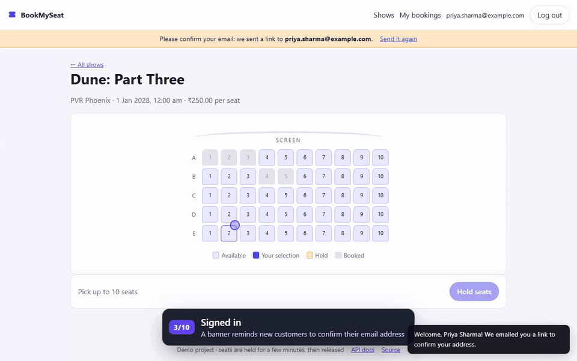](https://abhishek360007.github.io/BookMySeat/demo/)

<p>
  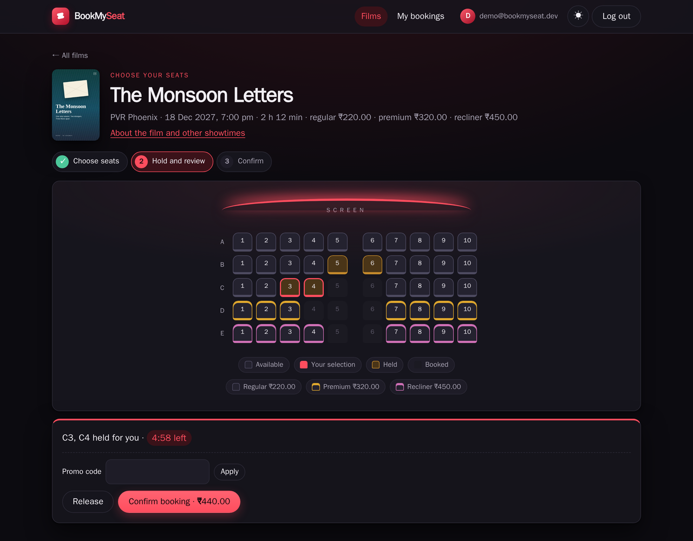
  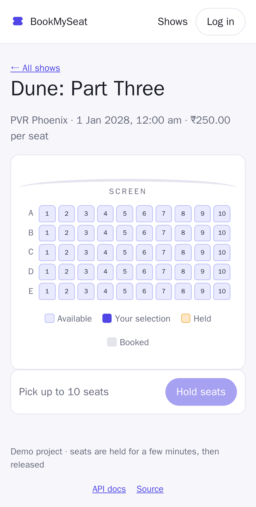
</p>

## Highlights

- **Redis seat holds with Lua:** selected seats are held for 5 minutes by one atomic script. Either every seat is held or none is, holds expire on their own, and this works across multiple app instances.
- **Optimistic locking (`@Version`):** the database is the final guard. When two confirms race for a seat, exactly one commit wins.
- **Proven with a 50-thread test:** Testcontainers tests fire 50 concurrent requests at one seat against real PostgreSQL and Redis, and CI runs them on every push.
- **Flyway-managed schema:** versioned SQL migrations, with Hibernate set to `validate`. CHECK constraints protect prices and totals in the database itself.
- **Hardened auth:** 15-minute JWT access tokens, rotating refresh tokens with stolen-token (reuse) detection, BCrypt passwords, `USER` / `ADMIN` roles, "forgot password" links that log out every session, a strict Content-Security-Policy, and per-IP rate limits on every auth endpoint. Errors are RFC 9457 `ProblemDetail` responses. See [Security](#security).
- **Online payments (Razorpay, test mode):** a booking exists only after a verified payment. Late payments, duplicate webhooks and a callback racing the webhook can never double-book or lose money: the customer is either booked or refunded.
- **Emails through a transactional outbox:** booking confirmed / cancelled / refunded emails and an optional email-verification link are stored in the same transaction as the change, then delivered with retries. A rolled-back booking never sends an email, and a provider outage never loses one.
- **Admin dashboard:** sales per show in a fixed number of queries, one form for venue + show + seat map, and booking-aware editing: a show with bookings can't change venue, a new time emails every customer, and cancelling a show refunds and emails everyone. A row lock stops a cancel and a payment from overlapping (a test fails without it).
- **E-tickets with QR check-in:** every booking gets an HMAC-signed ticket code, shown as a QR code in the web app and attached to the confirmation email. Staff scan it at the door with a phone camera; it gets in exactly once, even with 10 scanners reading it at the same moment.
- **Waitlist for sold-out shows:** customers join the line for 1 to 6 seats. When a booking is cancelled, the freed seats are held in Redis for the first person whose request fits, for 15 minutes, before the cancel even commits, so nobody can grab them in between. They get an email, book the seats like any other held seats, and an offer that runs out or is declined goes to the next person. See [Waitlist](#waitlist).
- **Promo codes:** percentage or fixed discounts with total and per-person limits that hold under parallel bookings (each use is counted under the code's row lock; 12 people racing for 5 uses get exactly 5), a use reserved for a Razorpay order and given back when it expires, is refunded or the booking is cancelled, and the discount kept on the booking like its price. See [Promo codes](#promo-codes).
- **Films and their screenings:** the home page lists films, each with its poster, rating, runtime, the next showtime and the cheapest seat; a film's page has its showtimes by day (in your city) and its reviews. Shows join a film by id or by title (created on the fly, one per title even when several shows are created at once), and the runtime ends the calendar event and times the review email. See [Films](#films).
- **Follow a film:** one email per follower when a film gets new showtimes, all of them together, 10 minutes after they're added (time to fix a mistake); each show announced once (ShedLock runs the job on one instance, and its row locks keep a second run off the same shows). See [Following films](#following-films).
- **Reviews from people who went:** a rating from 1 to 5 and an optional text, only with a confirmed booking for a screening that has started, one per person per film whichever screening they saw. The average sits on the film itself, kept exact by atomic updates in the review's transaction (6 saves by one person and 8 people at once give one review each and the right sum; the test fails without the lock), a "How was it?" email after the show, and admin moderation. See [Reviews](#reviews).
- **Accessible web app:** an axe-core audit of every page (WCAG 2.2 AA, phone and desktop, light and dark, 320 px wide) passes with no violations, and a browser test books seats with the keyboard alone: the seat map is one Tab stop with arrow keys, focus survives the live refresh, and screen readers hear about holds and waitlist offers. See [Accessibility](#accessibility).
- **Safe retries:** `Idempotency-Key` on booking confirmation, so a client that times out and retries gets the same booking back instead of an error or a duplicate.
- **Seat categories:** Regular, Premium and Recliner rows at their own prices, with aisles in the seat map. The total adds each seat's price on the server, and a booking keeps that total when prices or the layout change later.
- **Price snapshots and a cancellation cutoff:** a booking stores its total at booking time, and cancelling closes 2 hours before the show.
- **Observability with OpenTelemetry:** metrics and traces go to Grafana Cloud over OTLP. A dashboard and alert rules live in the repo as files, and the alerts are unit-tested with `promtool` in CI. Every log line carries the request id and the trace id, and business counters only move once their transaction commits. See [Monitoring](#monitoring).
- **Production-ready extras:** paginated admin reports, Actuator health and business metrics, a request id on every response and log line, JSON logs in production, and a layered, non-root Docker image with a CDS archive that halves cold-start time.

## Architecture

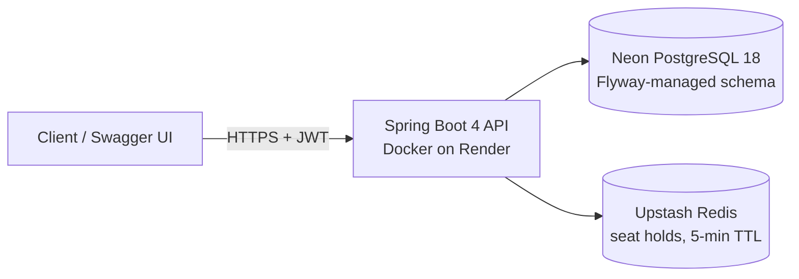

## Booking flow

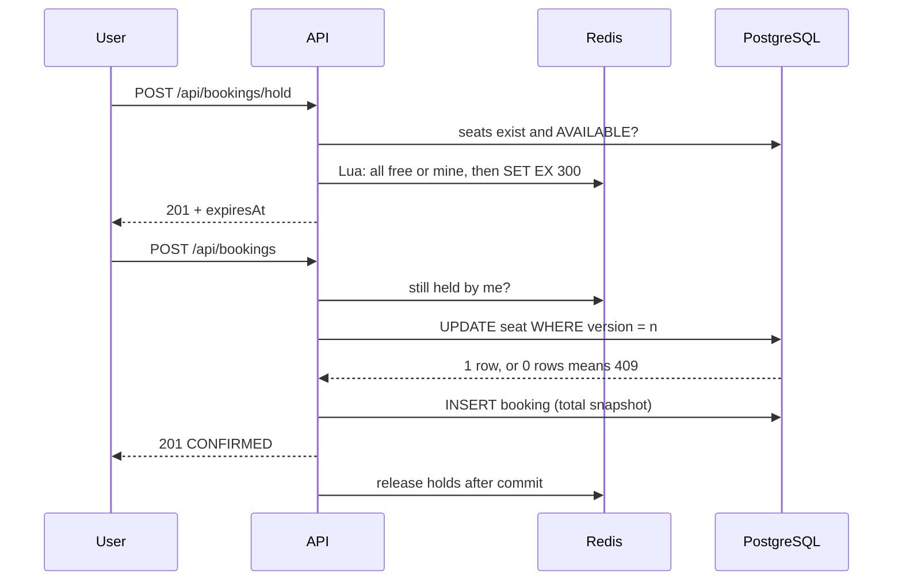

## Concurrency proof

Measured by the Testcontainers tests in this repo: 50 threads are released at the same instant by a `CountDownLatch`.

| Scenario | Result |
|---|---|
| 50 users **hold** the same seat | **1** succeeds, 49 get `409` |
| 50 users **confirm** the same seat (holds mocked as valid) | `ok=1`, `lockLost=49`: exactly **1** booking |
| Same booking race **without `@Version`** | **50 bookings for one seat** (the test fails, as it should) |

## Performance

Measured with [k6](https://k6.io) against the production Docker image (`prod` profile, connection pool of 5) on one machine (12 CPUs). Scripts are in [`load-tests/`](load-tests).

**Browsing** (50 virtual users searching, opening a show and loading its seat map for 55 s):

| Setup | Throughput | p95 search | p95 show | p95 seat map | Errors |
|---|---|---|---|---|---|
| Local database | ~1,250 req/s | 60 ms | 59 ms | 62 ms | 0 |
| Database with 20 ms latency, **no cache** | 82 req/s | 608 ms | 626 ms | 625 ms | 0 |
| Database with 20 ms latency, **Redis cache** | **214 req/s** | **4 ms** | **4 ms** | 675 ms | 0 |

The 20 ms of latency is added with [Toxiproxy](https://github.com/Shopify/toxiproxy) to mimic a managed database across the network (like Render → Neon). It shows the real bottleneck: each request holds one of only 5 pooled connections for several round trips, so requests queue. Caching shows and search results in Redis takes those requests off the database entirely. The seat map is deliberately not cached (it shows live holds), so it is now the remaining bottleneck.

**Ticket-release rush** (300 users each grab 2 random seats of the same 50, all at once, via hold → confirm):

| Result | Value |
|---|---|
| Confirmed bookings | 23 (46 seats) |
| Rejected at the hold step (`409`) | 277 |
| Seats sold twice | **0** (checked through the API and directly in the database) |
| Unexpected responses / server errors | 0 |

Run them yourself (app running on port 8080; raise the rate limits for the rush, since all virtual users share one IP):

```powershell
docker run --rm -v "${PWD}/load-tests:/scripts" -e BASE_URL=http://host.docker.internal:8080 `
  -e ADMIN_EMAIL=<admin> -e ADMIN_PASSWORD=<password> grafana/k6:2.3.0 run /scripts/browse.js
```

**Caching rules:** single shows are cached for 10 minutes and search results for 60 seconds. Any admin change to a show or venue clears the affected entries before the response returns (writes are synchronous: Lettuce would otherwise clear them in the background and a read straight after an edit could see old data, which a test caught). The cache is checked before a transaction starts, so a hit never borrows a database connection.

## Payments

Optional (`PAYMENTS_ENABLED=true`): **hold → checkout → pay with Razorpay → booking**. When off, bookings are confirmed directly, as before. The web app opens Razorpay Checkout automatically when payments are on.

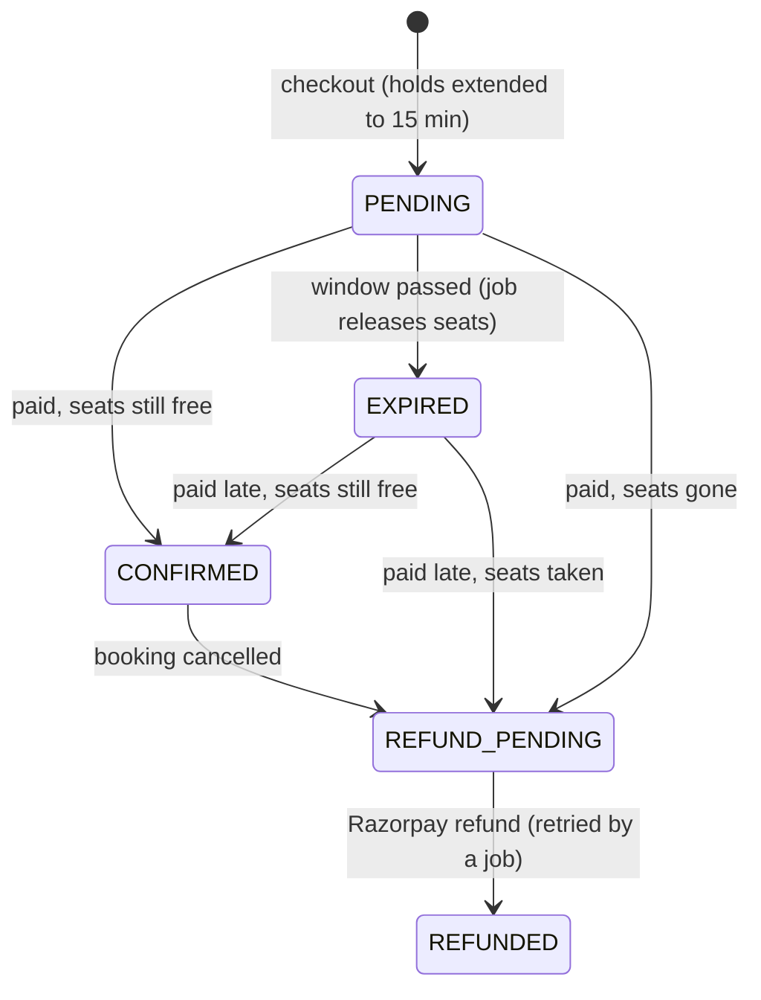

| Problem | How it's handled |
|---|---|
| Hold expiring during checkout | Checkout extends the user's holds to the 15-minute payment window (one atomic Lua script, all seats or none) |
| Payment arriving after the window | Booked if the seats are still free and nobody else holds them; otherwise refunded. Never double-booked |
| Webhook delivered more than once | Event ids are stored with `INSERT … ON CONFLICT DO NOTHING` in the same transaction as the processing, so a repeat is a no-op and a failed attempt can be retried |
| Client callback and webhook racing | Both go through one confirm path that locks the payment row; whichever arrives first wins, the other sees the result. Unique constraints on `order_id`, `payment_id` and `booking_id` back it up. Tested with 10 simultaneous reports: exactly 1 booking |
| Forged callbacks or webhooks | HMAC-SHA256 signatures (key secret for the callback, webhook secret over the exact raw body), compared in constant time |
| Price changed during checkout | The booking records the amount actually paid |
| Refund API failing | The payment stays `REFUND_PENDING`; a ShedLock job retries it. Refunds run after the decision commits, in their own transaction |
| Cancelling a paid booking | Refund recorded in the same transaction as the cancellation |

All of it is tested against real PostgreSQL and Redis with a fake Razorpay (`PaymentApiTest`, 19 tests).

## Admin dashboard

<p align="center">
  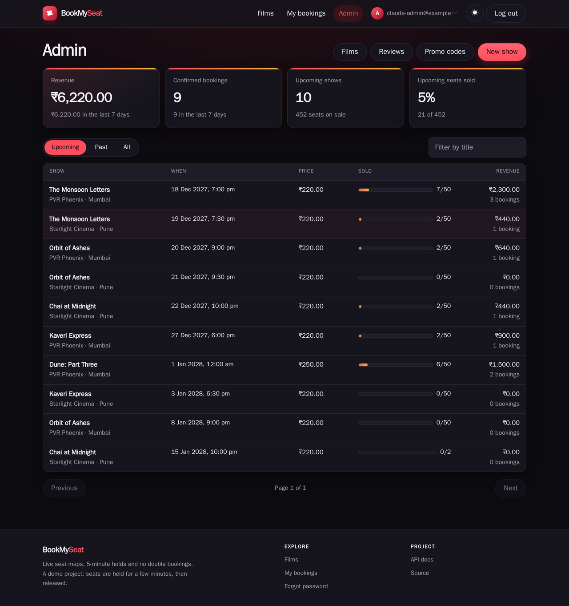
  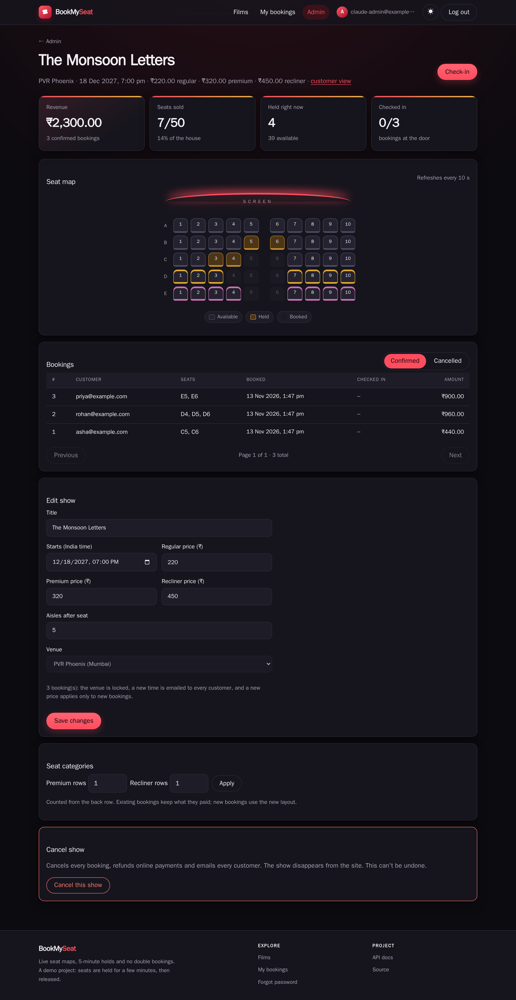
</p>

Admins get an **Admin** link in the web app (`#/admin`). The admin code is a separate module that loads only when an admin page is opened, so customers never download it, and every action goes through the same ADMIN-only API.

| Page | What it does |
|---|---|
| Dashboard | Revenue, confirmed bookings (all time and last 7 days), upcoming shows and the share of their seats sold; every show with a sold bar and its revenue; Upcoming / Past / All tabs and a title filter |
| New show | Pick a venue or create one inline, set the time (India time), prices, seat map size (e.g. 5 × 10 = A1–E10), premium and recliner rows and aisles in one form, with a preview of the full-house takings |
| Show page | Revenue, seats sold and seats held right now, a seat map refreshed every 10 s, bookings filtered by status, an edit form, and **Cancel show** |

**What happens to customers when a show changes:**

| Admin action | Without bookings | With bookings |
|---|---|---|
| Change title or price | Saved | Saved. Existing bookings keep the price they paid |
| Change the time | Saved | Saved, and every customer gets a "new time" email in the same transaction |
| Move to another venue | Saved | `409`: the seats belong to the venue's layout. Cancel and create a new show instead |
| Cancel the show | Hidden from the site | Every booking cancelled, online payments refunded, every customer emailed. Hidden from listings and search; its page shows a notice |

**Cancel vs. a payment in flight:** confirming a booking takes a shared row lock on the show (`FOR SHARE`, so bookings don't block each other) and cancelling takes an exclusive one (`FOR UPDATE`). Either the booking commits first and the cancel then cancels and refunds it, or the cancel commits first and the payment finds a cancelled show and is refunded. `ShowCancellationApiTest` races 8 payments against a cancel: every customer ends up refunded with no booking left. With the lock removed, the same test leaves confirmed bookings on a cancelled show.

**Fixed query count:** `GET /api/admin/shows` loads a page of shows, then the seat counts and the sales for all of them with one `GROUP BY` query each, so a page of 20 shows costs the same 4 queries as a page of 1. A test counts the SQL statements with Hibernate statistics.

## Seat categories and pricing

Each seat is **Regular**, **Premium** or **Recliner**. A show has a regular price (`price`) and optional prices for the other two; a category without its own price costs the regular one. Rows are counted from the back: generating seats with `premiumRows: 1, reclinerRows: 1` makes the back row recliners and the row in front of it premium. `aisleAfter: [5]` puts an aisle after seat 5 of every row.

| Rule | Why |
|---|---|
| The server adds up each seat's category price, for a direct booking and for a Razorpay checkout alike | The client never sends a price (`SeatCategoryApiTest`, `PaymentApiTest`) |
| A booking stores its total | Changing a price, or which rows are premium (`PUT /api/shows/{id}/seats/layout`), never changes what someone already paid; a checkout in progress keeps its amount |
| Existing seats became Regular (V14) | Shows created before categories existed cost exactly what they did |
| Category prices load with the show in checkout | Checkout runs outside a transaction on purpose (the Razorpay call mustn't hold a database connection), so it fetches the prices with the show in one query |

The seat map colours each category's top edge, lists the prices in a legend, leaves a gap at each aisle, and the summary adds the selected seats' prices. Show cards say "from ₹250" when categories cost different amounts.

## Best seats

**Pick best seats** under the seat map: choose how many (and a type, when the show has several) and the server picks and holds them. `BestSeatFinder` is plain Java with no Spring or database, so every rule has a unit test.

| Rule | Detail |
|---|---|
| Together | One row, consecutive seat numbers, no aisle in between, one category (the asked-for one, if any) |
| Best | Nearest the middle of its row and the row about two thirds of the way back from the screen (row A is the front); being off-centre sideways counts a little more than a row too near or too far |
| Always the same answer | Ties go to the row nearer the front, then to the leftmost block, whatever order the seats come in (tested by shuffling) |
| Free means free | Booked and held seats (anyone's) are never suggested: the pick works on the live seat map |
| Suggest or hold | `GET /api/shows/{id}/seats/best?count=&category=` only suggests, with the price; `POST /api/bookings/hold/best` picks and holds in one call, then you confirm or pay as usual |
| Someone was faster | The hold is the same all-or-nothing Lua script as a normal hold. If another person got any of the picked seats between the read and the hold, it picks again without that block (up to 10 tries); any other refusal stands. `BestSeatApiTest` sends 8 people at a 16-seat row at once: nobody gets a seat twice, and whoever is refused is refused because no 2 free seats together are left |
| No room | `409` "No 3 seats together are free right now", and nothing is held |

The web app announces which seats were picked, moves focus to the confirm button, and keeps the choices through the 10-second refresh. A rule against leaving a single empty seat beside a block was considered and is not in (yet).

## E-tickets and check-in

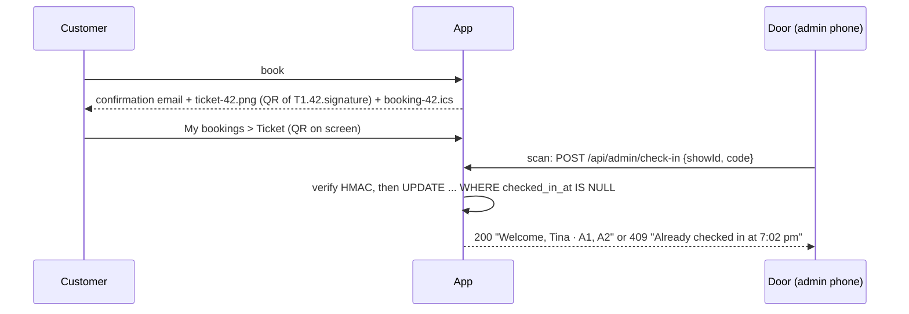

| Question | Answer |
|---|---|
| What's in the QR? | `T1.<booking id>.<signature>`: the first 128 bits of HMAC-SHA256 over the booking id. Without the server's key nobody can make a code for another booking, so booking ids being guessable doesn't matter |
| Where does the key come from? | `TICKET_SECRET`, or if that's not set, a key derived from `JWT_SECRET` (so a deployment needs no extra variable). Changing it invalidates every ticket issued |
| Can a ticket get in twice? | No. The check-in is one conditional `UPDATE ... WHERE checked_in_at IS NULL AND status = 'CONFIRMED'`: 1 row for the first scan, 0 for every later one. `CheckInApiTest` fires 10 scans of one ticket at once: 1 × `200`, 9 × `409` |
| What else is refused? | A forged or unreadable code (`400`), a cancelled booking, a ticket for another show, or a scan more than 6 hours before or after the start (`409`, with a machine-readable `reason`) |
| Can a cancellation erase a check-in? | No. The check-in also bumps the booking's `@Version`, so a cancellation that loaded the booking earlier fails its optimistic lock |
| How does the door scan? | The admin **Check-in** page uses the phone camera through the browser's `BarcodeDetector` (Chrome and Edge on Android); any browser can type the code instead. The result fills the screen in green or red |
| How does the email get the ticket? | The outbox stores the QR PNG with the email, so a retry sends exactly what was queued with the booking, over SMTP or Brevo |
| How does the show get into my calendar? | The confirmation email also carries `booking-42.ics` (RFC 5545: Google Calendar, Outlook and Apple Calendar import it), and the ticket and My bookings have **Add to calendar** (`GET /api/bookings/{id}/ticket.ics`). The event has the venue's address, the seats, the ticket code and a reminder an hour before |
| And when the show moves? | The reschedule email carries an updated file with the same `UID` and a higher `SEQUENCE` (the minute it was made), so a calendar moves the event instead of adding a second one |
| How long is the event? | The film's runtime (180 minutes for a film created without one) |
| Anything fiddly? | Times are written in UTC (no time zone blocks needed); commas, semicolons and line breaks in titles are escaped; lines over 75 bytes are folded without cutting a UTF-8 character in half (`₹` is 3 bytes); every line ends in CRLF. `CalendarEventsTest` checks each |

## Waitlist

When every seat of a show is booked (or held), the seat map offers **Join waitlist** for 1 to 6 seats. Seats that come free go to the line in order, as an offer: they are held for that person for 15 minutes (never past the show's start) and they get an email with a link. The show page then opens with those seats held and a countdown, so booking them (or paying for them) is the usual confirm.

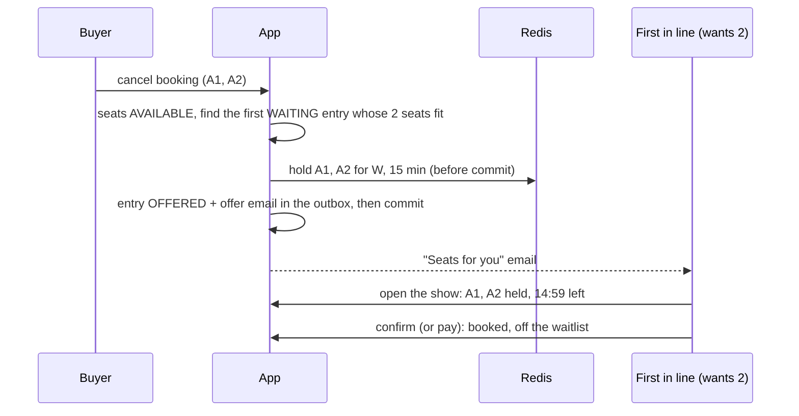

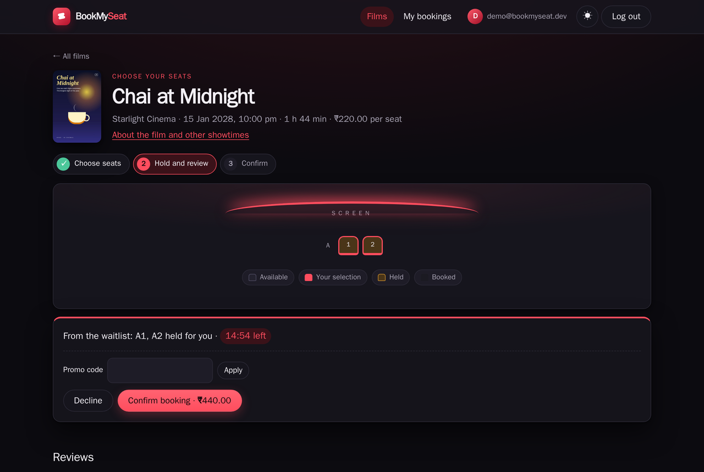

| Question | Answer |
|---|---|
| Who gets freed seats? | The earliest person in line whose request fits: someone waiting for 3 seats is skipped (not split) when 2 come free, and the next person who wants 1 or 2 gets them |
| Can someone else grab them first? | No. The hold is set in Redis inside the cancel transaction, while the seats are still `BOOKED` for everyone else, and it is removed again if that transaction rolls back (tested) |
| Two cancellations at once? | Offers for one show run one at a time, under a Postgres advisory lock held until commit, so the second sees whom the first offered to. The first version locked the waiting rows with `SKIP LOCKED` instead; a test of two simultaneous cancellations showed the first one locking the whole line, so the second offered nobody anything |
| What if they don't book? | A job (ShedLock, every minute) ends the offer when its time is up, and the seats go to the next person. Declining (leaving the waitlist), or booking only some of the offered seats, passes the rest on at once |
| Seats freed without a cancellation? | The same job offers any seat that is free and held by no one to the line: a customer's hold that ran out, or a declined offer. That's why a show counts as sold out for joining when every seat is booked **or held** |
| Can an offer be cut short? | No. A hold is never shortened by holding the same seats again (the hold script keeps the longer time), and a payment started in time keeps its seats after the offer ends |
| Show cancelled or started? | Cancelling closes the line and emails everyone in it; a show that starts closes its line quietly |
| Redis down? | Offers need holds, so none are made, but the customer's cancellation still succeeds and the job makes the offer once Redis is back (tested) |
| Counted? | `waitlist.joined` and `waitlist.offers` by result: `offered`, `claimed`, `expired`, `declined`, `closed` |

## Promo codes

Admins create discount codes on the **Promo codes** page (or `POST /api/admin/promo-codes`): a percentage, optionally capped (`20%, at most ₹150`), or a fixed amount (`₹50 off`), with optional limits: a minimum total, one show only, an end date, a number of uses in total and per person (once, by default). Customers type a code under their held seats, see the new total before they book, and the booking (and its payment) keeps the discount and the code, like its price.

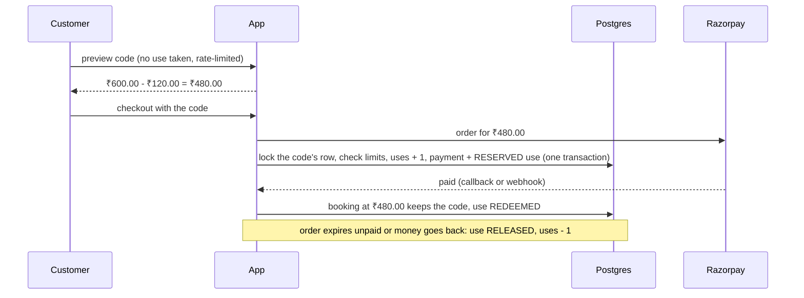

| Question | Answer |
|---|---|
| Can a code be used more often than its limit? | No. Every use is counted on the code's row while it is locked (`FOR UPDATE`), so bookings with the same code take turns, and a `CHECK (uses <= max_uses)` in the database refuses anything beyond it. Tested with 12 people booking at the same moment with a 5-use code: exactly 5 get it. Both race tests fail when the lock is removed: the bookings then collide on the code's `@Version` and most of them fail with `409` instead of being told the code ran out |
| And one person booking several times at once? | The per-person limit is checked under the same lock, so 4 parallel bookings by one person with a once-per-person code give one discount |
| What does a customer see when a code can't be used? | `422` with the reason: doesn't exist, not valid yet, expired, for another show, fully used, already used by you, total too small. In the web app it appears next to the field; nothing is booked and the seats stay held |
| With online payment? | The use is reserved when the Razorpay order is created, in the same transaction as the payment row, and Razorpay is asked for the discounted amount. A code that ran out between the price check and that transaction is a `422` and the order is never shown |
| Payment never completed? | When the order expires the use is given back; if the money arrives late anyway, it takes the use again only if the code still has room, otherwise it is refunded (tested both ways) |
| Booking cancelled? | Its use is given back, for a customer's cancellation and for a cancelled show alike. A paid booking is refunded the amount actually paid |
| Can a discount make a booking free? | No: it never leaves less than ₹1 to pay (Razorpay's minimum), and percentages are rounded to the paisa (`BigDecimal`, `HALF_UP`) |
| Guessing codes? | The price preview is rate-limited per IP (20 a minute) like the login |
| Retries? | The code is part of the `Idempotency-Key` fingerprint: the same key with another code is `422`. Checkout with the same seats and code returns the open order; another code makes a new one |
| Switched off? | New bookings can't use it; bookings made with it keep their discount |
| Counted? | `promo_codes.uses` by result: `redeemed`, `refused`, `released` |

## Films

A film is what its screenings have in common: title, runtime, language, certificate (U, UA, A, S) and a synopsis. Admins keep them on the **Films** page; a show belongs to one film.

<p>
  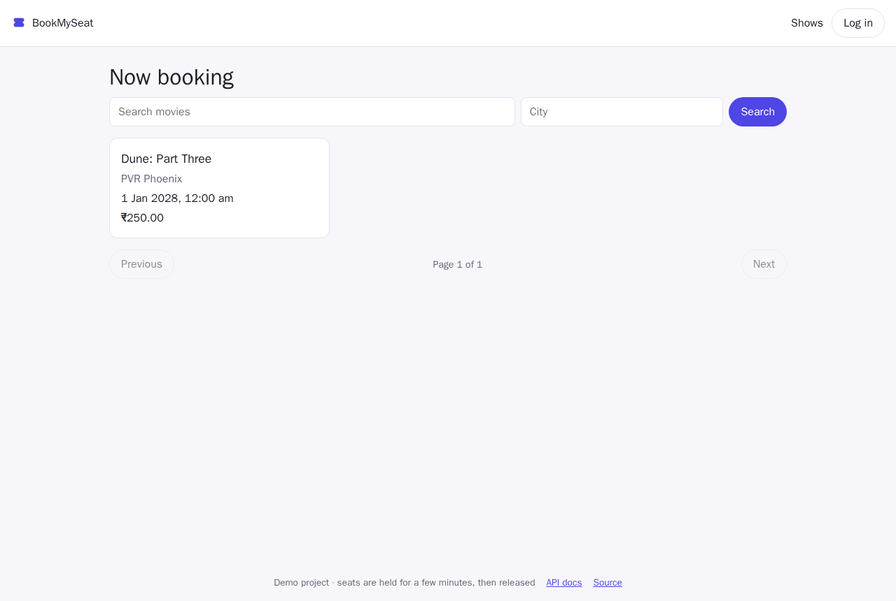
  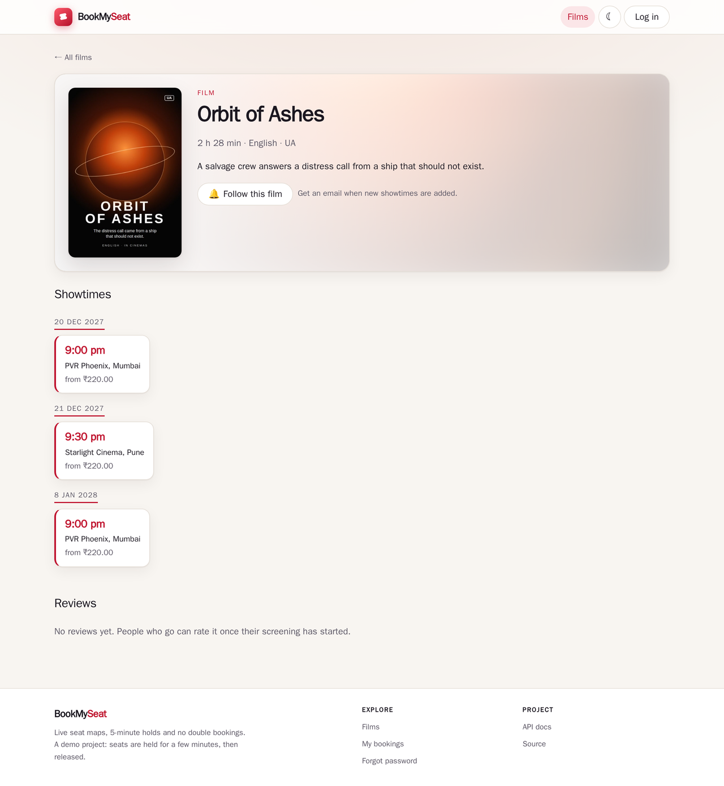
</p>

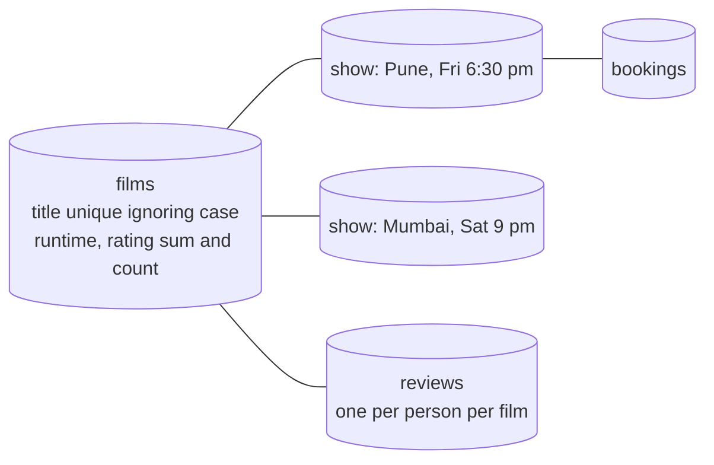

| Question | Answer |
|---|---|
| How does a show get its film? | `filmId`, or a `title`: the film with that title (ignoring case) or a new one (`runtimeMinutes` for it, 180 if left out). Creating shows keeps working as before, and the new-show form suggests the existing titles |
| Two shows with a new title at the same moment? | One film: the new film is inserted with `ON CONFLICT DO NOTHING` on the unique index of `lower(title)`, then read back. `FilmApiTest` creates 6 shows at once |
| What does the home page show? | Films with a screening coming up (in the city, if one is searched), the soonest first: rating, runtime, the number of showtimes, the next one and the cheapest seat. Three queries for any page: the page of film ids and its count, the films, their screenings with venues and prices. Cached in Redis for 60 seconds and cleared by any show, film or review change, like the show search |
| Renaming a film? | Its shows take the new title in the same transaction (tickets, emails and bookings read it there), and the cached shows are cleared |
| Can a show change film? | Not once it has bookings: its customers booked that film and their reviews count for it (`409`, like moving venue) |
| And the runtime? | The calendar event ends at the start plus the runtime, and the "How was it?" email goes out 30 minutes after that |
| Posters? | An admin uploads a JPEG or PNG (at most 5 MB) on the Films page; whatever comes in is stored as a 480 × 720 JPEG, cropped to 2:3 around the centre (`PosterImages`, plain Java with ImageIO, unit-tested). The type is read from the file's first bytes, not its name: a text file called `poster.png` is a `415`. The size is read from the header before decoding, and the image is decoded with subsampling (every n-th pixel), so even an 8000-pixel upload takes a few MB of memory on the 512 MB instance. Re-encoding drops the metadata (camera, location) |
| Where do they live? | In Postgres, in their own table (`film_posters`, V24), so listing films never reads an image; `films.poster_version` says there is one. `GET /api/films/{id}/poster` serves it with an ETag (`304` when unchanged) and a year of `immutable` caching, which is safe because the URL in every film carries the poster's version: a new poster is a new URL. At this size (about 40 KB each) a database is fine; object storage and a CDN would come with many more |
| No poster? | The card and the film page show the film's initials instead. The demo's made-up films have posters drawn in HTML and CSS ([`scripts/posters/make-posters.mjs`](scripts/posters/make-posters.mjs)); "Dune: Part Three" is a real film and keeps its initials |
| Existing shows? | V22 made one film per title (ignoring case) with 180 minutes, the length assumed until then, moved the ratings from the shows to the films (counted again from the reviews) and kept the newest review where someone had reviewed two screenings of one film. The shows' own rating columns stay for one release, because the previous version still reads them for a moment during the deploy |

## Reviews

People who went to a screening rate the film from 1 to 5 stars, with an optional text. The film's page and each of its screenings list the reviews (newest or highest rated first) under the film's average.

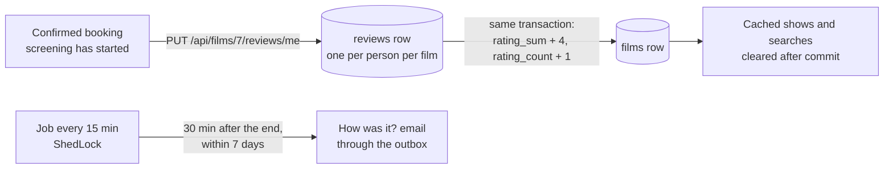

| Question | Answer |
|---|---|
| Who can review? | Only someone with a confirmed booking for one of the film's screenings, once that screening has started. Anyone else gets `409` with a `reason`: `NO_BOOKING` (no booking, or only a cancelled one) or `NOT_STARTED` |
| How many reviews per person? | One per film (a unique constraint), whichever screening and however many. Writing again edits it: `201` the first time, `200` after. `/api/shows/{id}/reviews/...` does the same for that screening's film |
| How is the average kept? | The film stores the sum and count of its visible ratings. Every change (new, edited, deleted, hidden, shown again) adds its difference with one atomic `UPDATE films SET rating_sum = rating_sum + ?` in the review's transaction, so listings show the average without counting reviews. The JPA columns are read-only, so an admin saving the film can't write an old value back, and a `CHECK` keeps the sum between 1 and 5 times the count |
| Two saves at the same moment? | The first takes a row lock on the person's bookings for the film's screenings (matched in a subquery, so only the booking rows are locked), so a second save (a double click, two tabs) waits and then edits the review instead of failing on the unique constraint. Edits, deletes and hiding lock the review row. `ReviewApiTest` fires 6 saves by one person (exactly one `201`) and 8 people at once (count 9, sum exact). Without the lock the test fails |
| And the cache? | Every cached screening and search carries the film's average, so a change clears them, after the commit. Before it, a reader could put the old average straight back |
| What do others see of me? | Your first name and the initial of your last name ("Asha K."), never the email. Text is trimmed, line breaks kept, control characters dropped, at most 1,000 characters, and escaped when shown |
| Moderation? | Admins see every review with its film and author on the **Reviews** page and can hide one: it leaves the list and the average, its author still sees it (and is told it's hidden), and it can be shown again |
| "How was it?" | A job every 15 minutes (one instance, ShedLock) looks at each confirmed booking once, 30 minutes after its show ended (start plus the film's runtime). It emails a link to the film's review page unless that person already reviewed the film or was asked about it through another booking. Shows that started more than 7 days ago are skipped, so a first deploy or a long sleep never emails about something long past. The demo account is never emailed |

## Following films

**Follow this film** on a film's page, and you get an email when it gets new showtimes. My bookings lists the films you follow, with what's coming up and **Stop following**.

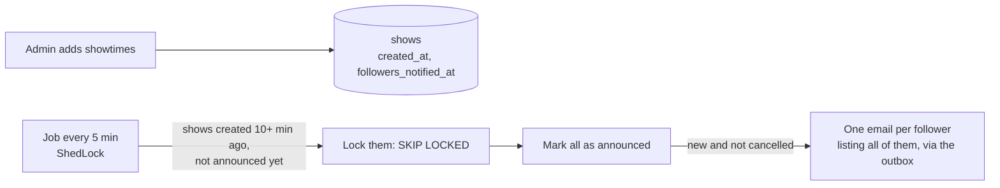

| Question | Answer |
|---|---|
| When is the email sent? | 10 minutes after a showtime is created at the earliest, so an admin can still fix or cancel a mistake: a job every 5 minutes picks up the shows created before then that nobody was told about. All of a film's new showtimes go in one email per follower, soonest first, with the venue and the cheapest seat |
| Can someone be told twice? | No. The job locks the film's unannounced shows (`FOR UPDATE SKIP LOCKED`), marks them all as announced, and queues the emails in the same transaction, so a second run, or a second instance, finds nothing left. A cancelled show, or one that has started by then, is marked without being mentioned |
| And the shows that existed before? | V25 marked them all as announced, so the first deploy emailed nobody about old showtimes (tested) |
| Following twice? | One follow: `INSERT ... ON CONFLICT DO NOTHING` (5 requests at once give one row, tested). Stopping when not following is fine too |
| The button? | A toggle (`aria-pressed`) whose name stays "Follow this film"; the line beside it says what it means and is announced when it changes. The bell and tick are CSS decoration with empty alt text, so they aren't read as part of the name. Logged out, it asks to log in first |
| Unsubscribing? | Every email says why it came and how to stop (the film's page, or My bookings). The shared demo account never gets one |

## Emails

Booking confirmed, booking cancelled, show rescheduled, refund completed, waitlist offer and waitlist closed, "How was it?" after a show, new showtimes of a film you follow, and a link to confirm the email address after registering. Each one has a plain-text and an HTML version; user-supplied text (names, show titles) is HTML-escaped.

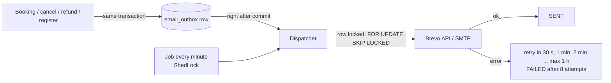

| Problem | How it's handled |
|---|---|
| Booking rolls back after the email was "sent" | Nothing is sent inside the transaction. The email is a row written in it, so it exists only if the booking committed (tested) |
| Email provider down | The row stays `PENDING` and the job retries with exponential backoff; the booking itself is unaffected (tested) |
| The same email sent twice by two senders | Each email is delivered while holding its row lock (`SKIP LOCKED`), so the after-commit send and the job never both send it. Tested with 3 parallel dispatchers: every email exactly once |
| Slow provider holding up the request | Delivery runs on a background thread after the commit; the API response never waits for it |
| App crashing after the provider accepted an email | Delivery is at least once: that email can be sent again. Booking emails tolerate a rare duplicate; losing one would be worse |
| The shared demo account | Its address is on `email.suppressed-recipients`, so demo visitors don't send mail to an inbox nobody owns |
| Attachments | Stored with the email in `email_outbox_attachment` (V19), in order, and deleted with it (`ON DELETE CASCADE`, since purging sent emails is a bulk delete). V13 had one attachment in columns of `email_outbox`; V19 moved them over but kept the columns for one release, because during a zero-downtime deploy the old version still runs for a moment and queues emails the old way. V21 then moved anything left and dropped them (tested by migrating a scratch schema to V20, queuing an email the old way and migrating on). During that deploy the V19 version, still running for a moment, can no longer read the outbox, so its after-commit sends fail and the new version's job delivers those emails within a minute: the outbox delivers at least once |

**Email verification** is optional: an unverified account can still book, and the web app shows a reminder with a **Send it again** button (3 per hour per IP). The link is single-use, expires after 24 hours and carries a random 256-bit token in the URL fragment (`#/verify/...`), which browsers never send to servers, so it doesn't end up in access logs. Only its SHA-256 hash is stored. Opening a used link again is not an error, because mail scanners often open links first. Accounts created before verification existed count as verified.

**Providers:** `EMAIL_PROVIDER=brevo` in production (Brevo's HTTPS API, because Render's free tier blocks outgoing SMTP), `smtp` for local development with [Mailpit](https://mailpit.axllent.org/) from `compose.yaml` (inbox at http://localhost:18025), and `log` by default, which only writes the recipient and subject to the log.

## Security

| Threat | Defence |
|---|---|
| Stolen database | Passwords are BCrypt hashes. Refresh tokens, verification links and reset links are random 256-bit values stored only as SHA-256 hashes, so a leaked table holds nothing usable |
| Stolen refresh token | Rotation with reuse detection: replaying a used token revokes that whole login session |
| Password guessing | 5 logins per minute per IP; changing the password needs the current one (5 tries per 15 min) |
| Finding out who has an account | "Forgot password" answers `202` for every address and only emails real accounts |
| Stolen reset link | Single use, expires after 1 hour, and a newer link cancels older ones. The token is in the URL fragment (`#/reset/...`), which browsers never send to servers, and the page removes it from the address bar |
| Account taken over through a reset | Every refresh token is revoked and a "your password was changed" email offers a reset. Access tokens are stateless, so one already issued keeps working for at most its remaining 15 minutes; no session can be renewed |
| The public demo account | Its password can't be changed or reset, and it never receives email |
| Cross-site scripting | All user text is escaped before it reaches the page, and the Content-Security-Policy only runs scripts from this site and Razorpay Checkout, never inline ones. A test fails if an inline script, style or `on...=` handler appears in the web app |
| Clickjacking | `frame-ancestors 'none'` and `X-Frame-Options: DENY` |
| Cross-site request forgery | Nothing is authenticated by cookies: the API reads a Bearer token from a header, which another site can't make a browser send |
| Forged payments and webhooks | HMAC-SHA256 signatures compared in constant time ([Payments](#payments)) |
| Vulnerable dependencies and code | Dependabot opens weekly update PRs (Maven, GitHub Actions, Docker base images); CodeQL scans the Java and JavaScript on every push and weekly, results under Security > Code scanning |
| Too much CI power | The workflows run with a read-only `GITHUB_TOKEN` |

Every response also carries `X-Content-Type-Options: nosniff`, `Referrer-Policy: strict-origin-when-cross-origin`, a `Permissions-Policy` that turns off camera, microphone and location, and HSTS on HTTPS. The Content-Security-Policy was checked against the real Razorpay Checkout in test mode: it needs inline styles (which Razorpay's script injects; they can't run code) and Razorpay's CDN for scripts, and nothing else.

## Design decisions

**Redis for holds, PostgreSQL for bookings.** Holds are short-lived, so Redis expires them with no cleanup job, and a Lua script makes "check all seats, then hold all" a single atomic step. Confirmed bookings are permanent records, so they live in PostgreSQL, the source of truth.

**Price is snapshotted.** `totalAmount = price × seats` is computed on the server when the booking is confirmed and is never recalculated. If an admin changes a show's price, past bookings keep what the customer actually paid, and the client can never send its own amount. A promo code's discount is snapshotted the same way: the booking keeps the discount and the code, and `totalAmount` is what was paid after it.

**`BigDecimal` for money.** In `double`, `0.1 + 0.2` is `0.30000000000000004`. Money is `BigDecimal` in Java and `NUMERIC(10,2)` in the database, and the API rejects more than 2 decimal places.

**Flyway with `ddl-auto=validate`.** The schema changes only through reviewed, versioned SQL files (`V1__init.sql`, `V2__...`). Hibernate checks on startup that the entities match the schema, and a migration that was edited after it ran fails its checksum check.

**Rotating refresh tokens.** Access tokens live 15 minutes, so a leaked one expires quickly. Refresh tokens are random 256-bit values stored only as SHA-256 hashes (a database leak reveals no usable tokens). Each refresh revokes the old token and issues a new one in the same "family"; if a revoked token is ever presented again, it was copied, so the whole family is revoked and both the thief and the user must log in again. A row lock stops two concurrent refreshes from both succeeding.

**Rate limiting in Redis.** A fixed-window counter per IP (one atomic Lua `INCR` + `EXPIRE`) is shared by all app instances. Over the limit, the API answers `429` with `Retry-After`. If Redis is down, the limiter fails open after a 2-second timeout, so an outage never locks everyone out of logging in.

**Request ids.** Every response carries `X-Request-Id`, every log line of that request includes it, and every error body has a `requestId` field, so a user's error report leads straight to the matching logs. A caller's own id is reused only if it is short and harmless (`[A-Za-z0-9._-]{1,64}`), which blocks log injection.

**Idempotency keys.** Confirming a booking with an `Idempotency-Key` header stores `pending` in Redis (`SET NX`, 60 s), then `done` + the booking id for 24 hours after the database commit. A retry with the same key and seats returns the original booking (`Idempotent-Replayed: true`); the same key with different seats is `422`; a duplicate that arrives while the first is still running is `409`. If the booking fails, the key is released so the client can retry. Measured: 5 parallel requests with one key give 1 × `201` and 4 × `409`, and exactly one booking.

**Scheduled jobs with ShedLock.** Expired refresh tokens are deleted by a background job (revoked-but-unexpired ones are kept, so reuse detection still works). ShedLock takes a row lock in Postgres first, so with several instances only one runs it. Because Render sleeps when idle, it runs 5 minutes after each wake-up and then every 6 hours rather than at a fixed time.

**Injectable `Clock`.** Time rules ("cancellation closes 120 minutes before start", "no booking after the show has started") read `Instant.now(clock)`. Unit tests use a fixed clock to cover the exact boundaries: 1 second before the cutoff, exactly at it, and 1 second after it.

**The `Asia/Calcutta` timezone bug.** On an Indian Windows machine the JVM's default zone is the legacy ID `Asia/Calcutta`. The PostgreSQL driver sends that zone to the server, and the PostgreSQL 18 test container rejected it with `invalid value for parameter "TimeZone"`. The app pins the JVM to UTC in `main()`, and Maven Surefire passes `-Duser.timezone=UTC` because tests don't run `main()`.

## API

Interactive docs: `/swagger-ui.html` (use **Authorize** to paste a JWT).

| Method | Path | Auth | Purpose |
|---|---|---|---|
| POST | `/api/auth/register` | Public | Create an account (always role `USER`; 5 per hour per IP) |
| POST | `/api/auth/login` | Public | Get a 15-minute access token and a 7-day refresh token (5 attempts per minute per IP) |
| POST | `/api/auth/refresh` | Public | Swap a refresh token for a new pair; the old refresh token stops working |
| POST | `/api/auth/logout` | Public | Revoke the session that a refresh token belongs to |
| POST | `/api/auth/verify-email` | Public | Confirm an email address with the token from the verification link |
| GET | `/api/users/me` | User | Current user's profile, including `emailVerified` |
| POST | `/api/users/me/verification-email` | User | Send a new verification link (earlier links stop working; 3 per hour per IP) |
| POST | `/api/users/me/password` | User | Change your password (needs the current one); every session is logged out and a new one is returned |
| POST | `/api/auth/forgot-password` | Public | Email a reset link if the account exists; always `202` (3 per hour per IP) |
| POST | `/api/auth/reset-password` | Public | Set a new password with the token from the reset link; logs out every session |
| GET | `/api/venues`, `/api/venues/{id}` | Public | Browse venues |
| POST / PUT / DELETE | `/api/venues/**` | Admin | Manage venues |
| GET | `/api/shows?venueId=`, `/api/shows/{id}` | Public | Browse shows and their prices |
| GET | `/api/shows/search?city=&q=&from=&to=&page=&size=&sort=` | Public | Search upcoming shows by city, title text and date range (paginated, soonest first) |
| POST / PUT / DELETE | `/api/shows/**` | Admin | Manage shows: `filmId` or a `title` (an existing film's, or a new one with `runtimeMinutes`); with bookings the venue and film are locked and a new time emails the customers |
| GET | `/api/shows/{showId}/seats` | Public | Seat map (`AVAILABLE` / `HELD` / `BOOKED`), each seat with its category and price |
| GET | `/api/shows/{showId}/seats/best?count=&category=` | Public | The best `count` free seats together (1 to 10) with their price, without holding them; `409` when no row has that many |
| POST | `/api/shows/{showId}/seats` | Admin | Generate seats, e.g. 5 rows × 10 = A1–E10, with optional `premiumRows` / `reclinerRows` at the back |
| PUT | `/api/shows/{showId}/seats/layout` | Admin | Change which rows are premium and recliner; existing bookings keep their totals |
| POST | `/api/bookings/hold` | User | Hold seats for 5 minutes |
| POST | `/api/bookings/hold/release` | User | Release your holds |
| POST | `/api/bookings/hold/best` | User | Pick and hold the best seats together: `{showId, count, category?}`; tries the next best block when someone else holds the picked one first |
| POST | `/api/promo-codes/preview` | User | Price held seats with a promo code: subtotal, discount, total; `422` with the reason when it can't be used (20 per minute per IP) |
| POST | `/api/bookings` | User | Confirm held seats (total computed on the server, minus an optional `promoCode`); optional `Idempotency-Key` header for safe retries. Only when payments are off |
| POST | `/api/bookings/checkout` | User | Payments on: create a Razorpay order for held seats (optional `promoCode`, its use reserved for the order); returns key id, order id and the discounted amount |
| POST | `/api/payments/verify` | User | Report a Razorpay payment (order id, payment id, signature); idempotent |
| GET | `/api/payments/{orderId}` | User | Payment status: `PENDING`, `CONFIRMED`, `EXPIRED`, `REFUND_PENDING`, `REFUNDED` |
| POST | `/api/payments/webhook` | Razorpay | Server-to-server payment events, authenticated by `X-Razorpay-Signature` |
| POST | `/api/bookings/{id}/cancel` | User | Cancel, up to 2 hours before the show |
| GET | `/api/bookings/{id}/ticket`, `/api/bookings/{id}/ticket.png` | User | Your e-ticket: signed code and details, or its QR code image |
| GET | `/api/bookings/{id}/ticket.ics` | User | Your booking as a calendar event (`text/calendar`), with the show's current time |
| POST | `/api/waitlist` | User | Join the waitlist of a sold-out show: `{showId, seats}` (1 to 6), once per show |
| DELETE | `/api/waitlist/{showId}` | User | Leave the waitlist (with an offer: decline it; the seats go to the next person) |
| GET | `/api/waitlist/me` | User | Your places in line: `WAITING` with your position, or `OFFERED` with the held seats and when the offer ends |
| GET | `/api/films?q=&city=&page=&size=` | Public | Films with a screening coming up, soonest first: rating, runtime, number of showtimes, the next three and the cheapest seat |
| GET | `/api/films/{id}` | Public | A film with its details, rating, `posterUrl` and every screening still to come |
| GET | `/api/films/{id}/poster?v=` | Public | The film's poster (480 × 720 JPEG), cached for a year by its versioned URL; `304` with `If-None-Match` |
| GET | `/api/films/{filmId}/reviews?sort=newest\|highest&page=&size=` | Public | A film's visible reviews (author as "Asha K."); its average and count are on the film and on each of its shows (`ratingAverage`, `ratingCount`) |
| PUT | `/api/films/{filmId}/reviews/me` | User | Write or edit your review: `{rating, text?}`; needs a confirmed booking for one of its screenings that has started (`409` with the `reason` otherwise) |
| DELETE | `/api/films/{filmId}/reviews/me` | User | Delete your review |
| GET, PUT, DELETE | `/api/shows/{showId}/reviews`, `/reviews/me` | Public / User | The same for that screening's film |
| PUT / DELETE | `/api/films/{id}/follow` | User | Follow a film (emailed about its new showtimes) or stop; both idempotent |
| GET | `/api/films/following` | User | The films you follow, newest first, with how many showtimes each has coming up |
| GET | `/api/reviews/me` | User | Your reviews, with `hidden` if an admin hid one |
| POST | `/api/admin/check-in` | Admin | Check a ticket in at the door (`showId` + scanned `code`); once only |
| GET | `/api/bookings/me` | User | Your bookings, newest first |
| GET | `/api/admin/shows/{showId}/bookings?status=&page=&size=&sort=` | Admin | Paginated bookings for a show (default `CONFIRMED`, newest first, max 100 per page) |
| GET | `/api/admin/shows/{showId}/summary` | Admin | Seats booked / held / available, confirmed bookings, revenue |
| GET | `/api/admin/overview` | Admin | Headline numbers: revenue and bookings (all time and last 7 days), upcoming shows and seats sold |
| GET | `/api/admin/shows?when=UPCOMING\|PAST\|ALL&q=&page=&size=&sort=` | Admin | Shows with seats sold, confirmed bookings and revenue |
| POST | `/api/shows/{id}/cancel` | Admin | Cancel a show: cancels and refunds its bookings and emails the customers |
| POST | `/api/admin/promo-codes` | Admin | Create a promo code: `PERCENT` (optional `maxDiscount`) or `FLAT`, optional `minTotal`, `showId`, `validFrom` / `validUntil`, `maxUses`, `maxUsesPerUser` (default 1) |
| GET | `/api/admin/promo-codes?page=&size=&sort=` | Admin | Promo codes with their uses, newest first |
| POST | `/api/admin/promo-codes/{id}/disable`, `/enable` | Admin | Switch a code off or on; bookings made with it keep their discount |
| GET | `/api/admin/films?q=&page=&size=` | Admin | Films with how many shows each has |
| POST / PUT | `/api/admin/films`, `/api/admin/films/{id}` | Admin | Create or edit a film (title unique ignoring case; a new title is carried to its shows) |
| PUT / DELETE | `/api/admin/films/{id}/poster` | Admin | Upload a poster (multipart `file`, JPEG or PNG up to 5 MB; `415`, `422` or `413` with the reason when it can't be one) or remove it |
| GET | `/api/admin/reviews?hidden=&page=&size=` | Admin | Reviews with their show and author, newest first |
| POST | `/api/admin/reviews/{id}/hide`, `/unhide` | Admin | Hide a review (not listed, not in the average) or show it again |

`401` means no valid token, and `403` means a valid token without the required role.

## Run locally

**Prerequisites:** Java 21 and Docker Desktop (running). Spring Boot starts PostgreSQL, Redis and Mailpit from `compose.yaml`, and Flyway creates the schema on first start.

```powershell
git clone https://github.com/Abhishek360007/BookMySeat.git
cd BookMySeat

# Optional: create an admin on startup (credentials never live in the repo)
$env:ADMIN_EMAIL="admin@bookmyseat.dev"
$env:ADMIN_PASSWORD="choose-a-strong-password"   # at least 12 characters

.\mvnw spring-boot:run        # macOS/Linux: ./mvnw spring-boot:run
```

Then open **http://localhost:8080/swagger-ui.html**.

| Variable | Purpose | Default |
|---|---|---|
| `JWT_SECRET` | HS256 signing key (at least 32 bytes) | Dev-only value. **Always set it in production.** |
| `ADMIN_EMAIL` / `ADMIN_PASSWORD` | Admin account created on startup | Not set (no admin is created) |
| `PAYMENTS_ENABLED` | Require a Razorpay payment before a booking | `false` |
| `RAZORPAY_KEY_ID` / `RAZORPAY_KEY_SECRET` / `RAZORPAY_WEBHOOK_SECRET` | Razorpay test-mode API keys and webhook secret | Not set |
| `EMAIL_PROVIDER` | `log`, `smtp` (Mailpit: inbox at http://localhost:18025) or `brevo` | `log` |
| `EMAIL_FROM` / `BREVO_API_KEY` | Sender address (a verified sender in Brevo) and Brevo API key | `no-reply@bookmyseat.dev` / not set |
| `APP_PUBLIC_URL` | Where links in emails point | `http://localhost:8080` |
| `TICKET_SECRET` | Key that signs e-ticket codes | Derived from `JWT_SECRET` |
| `OTLP_ENABLED` | Send metrics (once a minute) and traces over OTLP | `false` |
| `OTLP_ENDPOINT` / `OTLP_AUTHORIZATION` | OTLP endpoint (Grafana Cloud's gateway in production) and its `Basic …` header (prod profile only) | `http://localhost:14318` / not set |

**Local Grafana:** `docker compose --profile monitoring up -d lgtm` starts Grafana with Prometheus, Tempo and Loki in one container; run the app with `OTLP_ENABLED=true` and open **http://localhost:13000** (admin / admin). Metrics arrive under `job="BookMySeat"`, traces in Tempo under the service `BookMySeat`.

Hold duration and the cancellation cutoff are in [`application.properties`](src/main/resources/application.properties).

## Web app

A small single-page app served by the same Spring Boot server at `/` (same origin, so no CORS; one Docker image, one deploy). Plain HTML, CSS and JavaScript modules with **no build step**, so it adds no Node toolchain to the Dockerfile or CI.

| Feature | Detail |
|---|---|
| Films | The home page lists the films showing with their posters (title and city filters, paginated); a film's page has its poster, synopsis, showtimes by day (keeping the city searched) and reviews; the seat map links back to the film. Posters are decorative (`alt=""`, the title is beside them), lazy-loaded, with their size reserved so nothing jumps; a film without one shows its initials |
| Live seat map | Available / held / booked, refreshed every 10 s, so other people's holds appear without reloading; seat categories with their prices, and aisles |
| Hold with countdown | Held seats are outlined as yours; the hold is released automatically when the timer ends |
| Pick best seats | Choose how many seats (and a type) and the server picks and holds the best ones together; which seats is announced, and a show without that many together says so |
| Safe confirm | Every confirm sends an `Idempotency-Key`, so a double click or a retry can't book twice |
| Promo codes | A code field under the held seats: **Apply** shows the discount and the new total on the button, a refused code is explained next to the field, and what you type survives the 10 s refresh. My bookings shows what a code took off |
| Waitlist | A sold-out show offers **Join waitlist** (1 to 6 seats) and then shows your place in line; an offer appears within one refresh as held seats with a countdown, to book or **Decline**. My bookings lists your places in line |
| Payments | When payments are on, **Pay** opens Razorpay Checkout and the page verifies the result (the webhook confirms too, even if the tab is closed) |
| Sessions | Access token in memory only; the refresh token in `sessionStorage`, renewed automatically on a `401` |
| Admin pages | Dashboard, new show form, a page per show, **Films** (newest first with a title search, 20 a page; create and edit, with their number of shows; upload or remove a poster), **Promo codes** (create codes with a live example of the discount, see their uses, switch them off) and **Reviews** (all, visible or hidden; hide or show again) for admins (see [Admin dashboard](#admin-dashboard)) |
| Following | **Follow this film** on a film's page (a toggle that says what it does); My bookings lists the films you follow with what's coming up, and **Stop following** |
| Reviews | The film's page and its screenings carry the average ("★ 4.3 · 12 reviews") and list the reviews, newest or highest rated first. After the start, My bookings swaps **Cancel** for **Rate this film** (or your stars, to edit). The review page is a 5-star radio group (arrow keys work, lit stars are filled and the others outlined, so not only the colour tells them apart) and an optional text |
| E-tickets | A **Ticket** button on each booking: QR code, seats and code, and "checked in" once scanned. **Add to calendar** on the ticket and in My bookings downloads the `.ics` (with the login token, so through a `blob:` URL) |
| Check-in (admins) | Pick the show, then scan tickets with the phone camera or type the code; a big green or red answer and a live "12 of 40 checked in" counter |
| Passwords | "Forgot password?" in the login dialog, a reset page for the emailed link, and an account page (click your email in the top bar) to change the password |
| Email verification | A reminder banner with **Send it again** until the email is confirmed; the `#/verify/...` page removes the one-time token from the address bar |
| Look | A cinema look: warm paper and theatre red by day, a dark auditorium with a red and gold glow by night. Home opens with a featured film on a lit band and quick city chips over a poster grid (rating and certificate badges, **Book tickets** on hover, shimmering placeholders while it loads); a film's page is lit by its own (blurred) poster, the seat map has a curved screen glowing towards the seats, the seat map page shows the poster and a steps bar (Choose seats, Hold and review, Confirm or Pay), the booking bar stays at the foot of the screen with the hold timer as a pill, and the e-ticket is a ticket stub with a torn perforation. Plain CSS with colour tokens: no framework and no web fonts (the Content-Security-Policy allows fonts only from the app itself) |
| Phones and themes | Responsive down to 360 px wide. Follows the system light/dark setting until the moon/sun button in the top bar picks one; the choice is remembered in this browser and set by a small script in `<head>` before the page is drawn, so the other theme never flashes |
| Accessibility | Keyboard-only booking, screen reader announcements, reduced motion and Windows High Contrast; see below |

### Accessibility

Checked by two browser tests rather than by eye. [`e2e/a11y-audit.mjs`](e2e/a11y-audit.mjs) runs [axe-core](https://github.com/dequelabs/axe-core) (WCAG 2.2 A and AA rules plus axe's best practices) on 31 pages, from the films, a followed film, the seat map, a refused promo code and the login dialog to the ticket, a review and the admin films (with a poster) and reviews, each on a desktop and a phone screen in the light and the dark theme, and checks that each page fits 320 px wide (a 1280 px window at 400% zoom) without sideways scrolling: 155 checks. The promo codes page failed that last check at first: a visually hidden table heading made it 124 px too wide, because the scrolling table around it wasn't positioned. [`e2e/keyboard-flow.mjs`](e2e/keyboard-flow.mjs) books two seats without the mouse and checks where focus goes on the way.

| What | How |
|---|---|
| Keyboard | A **Skip to content** link; after moving to another page, focus is on its heading (and the browser tab is named after it). The seat map is one Tab stop: arrow keys move between seats (up and down to the nearest seat in the next row), Home and End along a row, Space picks |
| Focus that stays put | The seat map and the summary are redrawn on every pick and every 10 s refresh; whatever had focus there gets it back, also after logging in through the dialog. Before this, a refresh dropped keyboard users back to the top of the page |
| Seats for screen readers | Every seat is a button named like "Seat C5, available, premium ₹350.00" in a group per row; booked and held seats stay reachable (`aria-disabled`, not `disabled`), so they are heard as booked instead of skipped |
| Announcements | Two live regions that exist from the start: errors interrupt, everything else is polite. A hold ("Seats A3, B3 are held for you for 5 minutes"), a waitlist offer arriving while you're on the page, and one warning a minute before a hold ends; the countdown itself stays silent |
| Contrast and colour | Text contrast passes in both themes (the audit found the email banner's link too light in dark mode; every colour of the Week 29 redesign was picked for 4.5:1, and its audit found the login dialog's small links too small to tap, now 24 px tall). In Windows High Contrast, where background colours are replaced, seat states differ by system colours and border styles |
| Motion | With "reduce motion" set, nothing fades or slides |

The first audit found 3 problems: that contrast issue, an admin table that scrolled sideways on phones but couldn't be reached with the keyboard, and pages without an `h1`. The keyboard test found what axe can't: the focus lost on every seat map refresh.

**Browser tests:** [`e2e/booking-flow.mjs`](e2e/booking-flow.mjs) drives headless Chromium (Playwright) through the whole journey: browse films → a showtime on the film's page → pick 2 seats → log in → hold → a second visitor sees the seats as held → confirm → my bookings → cancel, plus a phone-sized layout check. With `MAILPIT_URL` set it also registers a new account, reads the verification email from Mailpit and opens its link. [`e2e/admin-flow.mjs`](e2e/admin-flow.mjs) checks that a customer can't open the admin pages, then as an admin creates a venue, show and seat map, sees a customer's booking arrive, reschedules the show (and with Mailpit checks the customer's email) and cancels it. [`e2e/password-flow.mjs`](e2e/password-flow.mjs) goes through "Forgot password?", the emailed link, logging in with the new password and changing it on the account page, and fails on any Content-Security-Policy violation. [`e2e/ticket-flow.mjs`](e2e/ticket-flow.mjs) opens a customer's ticket, downloads its calendar event from the ticket and from My bookings (file name, UID, start time in UTC, title, ticket code), checks it in on the admin check-in page, and makes sure a second scan and a forged code are refused. [`e2e/waitlist-flow.mjs`](e2e/waitlist-flow.mjs) builds a sold-out show, joins its waitlist in the browser, cancels the booking and waits for the offer to appear on the page with its countdown (and in Mailpit), books it, then gives a second person an offer that they decline. [`e2e/promo-flow.mjs`](e2e/promo-flow.mjs) creates a code on the admin page, has a customer told why a wrong code is refused, apply the real one, book at the discounted price and then lose a second code to someone who booked first (refused at confirm, booked at full price), and checks the uses and discounts on the admin pages. [`e2e/best-seats-flow.mjs`](e2e/best-seats-flow.mjs) lets the app pick 2 seats on a show with an aisle and a recliner row, hears which were picked, asks for recliners, then for more seats together than any row has (told why, nothing held), and gets the next best pair while someone else holds the middle, also with the keyboard only and on a phone. [`e2e/film-flow.mjs`](e2e/film-flow.mjs) creates a film on the admin Films page and two showtimes with the New show form, finds the film on the home page (its next showtime and cheapest seat), narrows it to a city, picks a showtime on the film's page and reaches the seat map, uploads a poster after a text file named .png is refused and sees it on the home card at 480 × 720, then renames the film and sees its shows follow, and removes the poster. [`e2e/follow-flow.mjs`](e2e/follow-flow.mjs) asks a visitor to log in before following, follows a film with no showtimes yet, lets an admin add two and reads exactly one email listing both from Mailpit, then stops following from My bookings. [`e2e/review-flow.mjs`](e2e/review-flow.mjs) books a show that starts a minute later, is told to wait until it has started, then rates it from My bookings (a missing rating is explained, the stars work with the arrow keys), sees the review and the average, watches a second customer's 1-star spam drag the average down until an admin hides it, and edits and deletes the review, also on a phone. [`e2e/theme-flow.mjs`](e2e/theme-flow.mjs) checks the theme button: the system setting is followed until a choice, the toggle works with the keyboard and says whether it is on, the choice survives a reload and wins over the system both ways, it still switches when storage is blocked, and the nav marks only the section you're in (it caught Films marked on the password pages). [`e2e/a11y-audit.mjs`](e2e/a11y-audit.mjs) and [`e2e/keyboard-flow.mjs`](e2e/keyboard-flow.mjs) check accessibility (see [Accessibility](#accessibility)). All of them fail on any JavaScript error. They caught real bugs before release: `crypto.randomUUID()` only exists on HTTPS/localhost (fixed with a fallback), the seat map was cut off on phones, the venue dropdown had no usable accessible name, and a slow page could draw over the one clicked after it (pages now render in order).

```powershell
# app running on port 8080 with the demo data (scripts/seed-demo.ps1)
docker run --rm -v "${PWD}/e2e:/e2e" -e BASE_URL=http://host.docker.internal:8080 mcr.microsoft.com/playwright:v1.64.1-noble `
  sh -c "npm i --no-save --prefix /tmp/pw playwright@1.64.1 && cp /e2e/booking-flow.mjs /tmp/pw/ && cd /tmp/pw && node booking-flow.mjs"
```

## Run with Docker

No Java needed: the app runs as a container next to PostgreSQL and Redis.

```powershell
copy .env.example .env      # then set ADMIN_EMAIL, ADMIN_PASSWORD and JWT_SECRET (.env is git-ignored)
docker compose --profile app up -d --build
```

Open **http://localhost:8080/swagger-ui.html**. To stop only the app container and keep the databases running, use `docker compose stop app`.

- **Multi-stage build:** the JDK and Maven exist only in the build stage; the runtime image has just the JRE.
- **Layered for caching:** dependencies are downloaded before the source is copied, and the jar is split into Spring Boot layers. A code change rebuilds only the small application layer (about 0.4 MB); a cached rebuild takes about 15 seconds.
- **Non-root:** the app runs as `uid=1001(app)`.
- **Profile-gated:** plain `docker compose up`, and Spring Boot's own Docker Compose support, still start only the databases.

## Monitoring

| Endpoint | Access | Shows |
|---|---|---|
| `/actuator/health` | Public | `UP` / `DOWN` only. Admins also see components: `db`, `redis`, disk. |
| `/actuator/health/liveness`, `/actuator/health/readiness` | Public | Probes for Kubernetes or a load balancer |
| `/actuator/info` | Public | Build artifact, version and time |
| `/actuator/metrics/{name}` | Admin | JVM, HTTP and the business metrics below |

| Metric | Tags | Counts |
|---|---|---|
| `bookings.confirmed` | none | Successful bookings |
| `bookings.seats` | `category` = `regular` / `premium` / `recliner` | Seats sold |
| `bookings.revenue` | none | Value of confirmed bookings in rupees (what was paid, for online payments) |
| `bookings.cancelled` | `by` = `customer` / `show` | Cancellations; `show` = an admin cancelled the whole show |
| `seat.holds` | `result` = `success` / `conflict` | Hold attempts, including lost hold races |
| `waitlist.joined`, `waitlist.offers` | `result` = `offered` / `claimed` / `expired` / `declined` / `closed` | People joining a waitlist, and offers of freed seats and how each one ended |
| `booking.conflicts` | `reason` = `hold_missing` / `already_booked` / `lock_lost` | Why confirms were rejected; `lock_lost` is an optimistic-lock race lost at commit |
| `payments` | `outcome` = `confirmed` / `refund` / `expired` / `attempt_failed` | What happened to Razorpay orders |
| `refunds` | `outcome` = `refunded` / `retry` / `manual` | Refund requests; `manual` = an extra payment Razorpay refused to refund, to do from its dashboard |
| `emails` | `kind`, `outcome` = `sent` / `retry` / `failed` | Outbox deliveries |
| `emails.outbox.pending`, `emails.outbox.oldest_pending_seconds`, `emails.outbox.failed` | none | Gauges, refreshed each minute: emails waiting, how long the oldest has waited, emails given up on |
| `checkins` | `result` = `ok` / `invalid` / `already_checked_in` / `cancelled` / `other_show` / `too_early` / `too_late` | Ticket scans at the door |
| `rate_limit.rejected` | `endpoint` = `login` / `register` / `verification-email` / `forgot-password` / `change-password` | Requests turned away with `429` |

Counters only move once their transaction commits, so a rolled-back confirm is never counted as a booking. Tags never contain user, show or seat ids, which keeps the number of distinct metrics small.

**Logs:** every request is logged once (`GET /api/shows/2 -> 200 in 15 ms`) with its request id and trace id; health probes are skipped. Locally they appear in brackets (`[3f2a…] [trace 4bf9…]`); in production (`prod` profile) each line is a JSON object in Elastic Common Schema, with `requestId` and `traceId` as fields.

**Grafana Cloud (OpenTelemetry):** with `OTLP_ENABLED=true` the app sends metrics once a minute and every trace over OTLP, gzipped, to Grafana Cloud's free tier (about 600 series):

- **Traces:** one per request, with spans for Spring Security, each Redis call, each database connection and query (SQL with `?` placeholders, never the parameter values), and the calls to Razorpay and Brevo. The server span carries `request.id`, so the id in an error body leads to the trace. Health probes, the jobs' idle polling and queries outside a request (Flyway at startup) create no traces; a Brevo or Razorpay call from a job still shows up.
- **What the database spans found:** a login held its database connection for 1.5 to 1.9 s while its queries took 0.1 s, because the BCrypt check (about 1.3 s at 0.1 CPU) ran inside the login's transaction. Five logins at once would have taken production's whole pool of 5. Now the password is checked outside any transaction, and a login holds a connection for 0.1 to 0.3 s (measured in a 0.1 CPU container; `LoginConnectionTest` keeps it that way). The first login after a wake-up still takes about 26 s, almost all of it loading and compiling classes outside any connection.
- **Dashboard:** [`monitoring/bookmyseat-dashboard.json`](monitoring/bookmyseat-dashboard.json): requests, errors, p95 latency, bookings and booking value, seats by category, holds and conflicts, check-ins, payments, refunds, the email outbox, query time, how long a connection is held and waited for, JVM memory and CPU, and how long each start took (every wake-up on Render is one).
- **Alerts:** [`monitoring/alerts.yaml`](monitoring/alerts.yaml): server errors, slow requests, a restart loop, an email backlog or given-up emails, a refund to do by hand, failing refunds, requests waiting for a database connection or failing for lack of one, a nearly full heap. [`alerts.test.yaml`](monitoring/alerts.test.yaml) proves each one fires on a bad case and stays quiet on a normal one, and CI runs it.
- **Counting across restarts:** the free instance sleeps after 15 idle minutes, and each wake-up starts the counters again. Business counters exist at 0 from startup, and the dashboard's totals count a series that is new in the range from 0. There is no "app is down" alert, because missing metrics are normal while it sleeps.

Locally, `docker compose --profile monitoring up -d lgtm` starts the same stack (Grafana, Prometheus, Tempo) in one container. [`monitoring/push-to-grafana.py`](monitoring/push-to-grafana.py) creates the dashboard and the alert rules in a Grafana stack (the production one was set up with it), and [`monitoring/README.md`](monitoring/README.md) covers that and the counting rules.

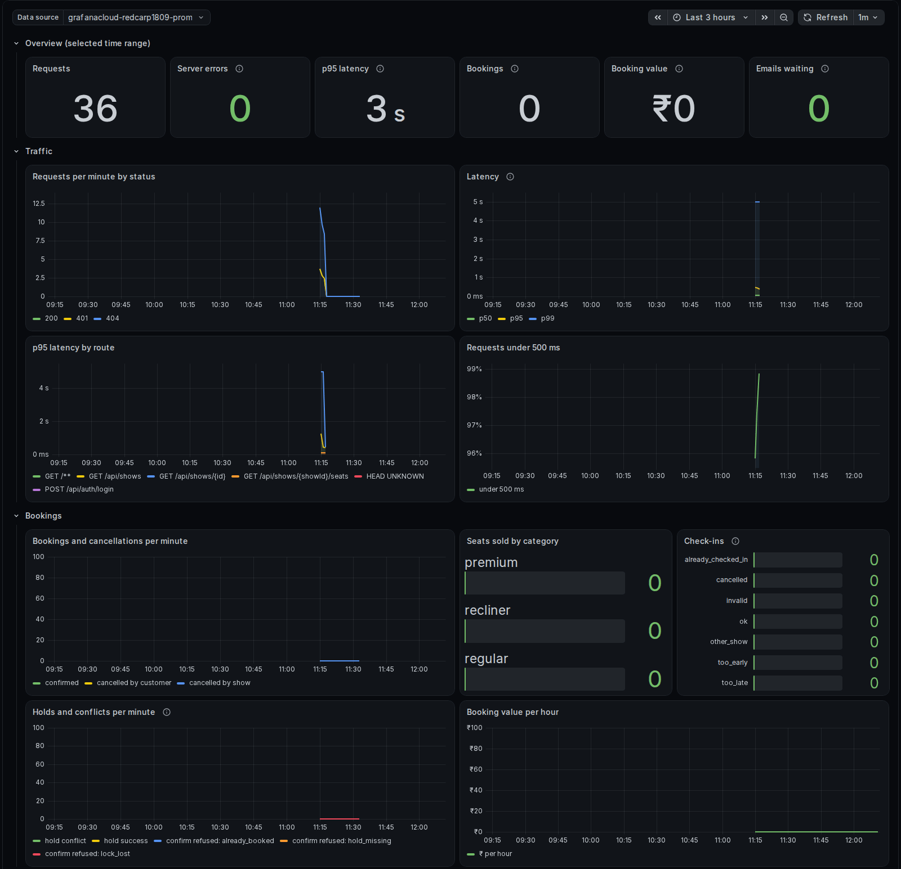

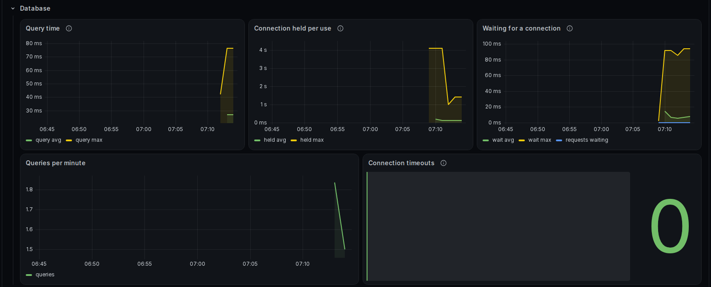

## Deployment

The live demo runs entirely on free tiers, all in Singapore (AWS ap-southeast-1) to keep latency low:

| Piece | Service | Notes |
|---|---|---|
| App | **Render** web service, built from this repo's `Dockerfile` | 512 MB RAM, 0.1 CPU; sleeps after 15 minutes without traffic |
| Database | **Neon** PostgreSQL 18 | Direct (non-pooled) connection over TLS; Flyway migrates it on startup |
| Holds | **Upstash** Redis | TLS (`rediss://`); the Lua hold/release scripts run unchanged |
| Monitoring | **Grafana Cloud** | Metrics and traces over OTLP (`ap-south-1` gateway), dashboard and alerts from [`monitoring/`](monitoring/) |

**Start page for the sleeping demo:** the free instance sleeps after 15 idle minutes, and the first visitor would stare at a blank page for 2 to 3 minutes. The demo link therefore opens [`docs/index.html`](docs/index.html) on GitHub Pages, which loads instantly. It asks the app's liveness probe, the one path another origin may read (CORS for the Pages address only), and opens the app as soon as it answers `UP`; a Render error page during a deploy doesn't count. If the app is awake, that takes under a second. Measured live after 17 idle minutes: the start page was there in 1.3 s, showed the wake-up with progress, and opened the running app after 170 s, with no errors.

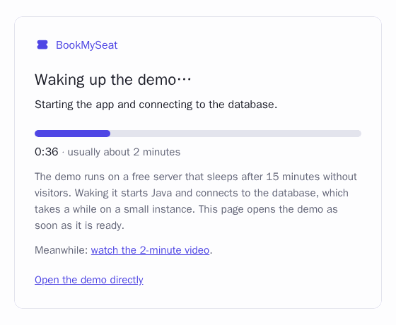

**Continuous deployment:**

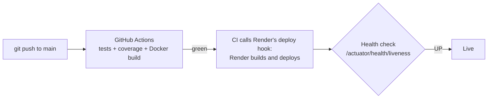

The last CI step calls Render's deploy hook (stored as the GitHub secret `RENDER_DEPLOY_HOOK_URL`), so only a commit whose tests, coverage and Docker build are all green reaches production.

**Configuration:** production settings live in the `prod` profile ([`application-prod.properties`](src/main/resources/application-prod.properties)) and come entirely from environment variables: `DB_URL`, `DB_USERNAME`, `DB_PASSWORD`, `REDIS_URL`, `JWT_SECRET`, `ADMIN_EMAIL`, `ADMIN_PASSWORD`, plus the payment and email variables above and `OTLP_ENABLED` / `OTLP_ENDPOINT` / `OTLP_AUTHORIZATION` for Grafana Cloud. No secrets are in the repo, and production uses its own JWT secret.

**Faster cold starts with CDS:** the Docker build does a training run that starts the app and saves every loaded class into a Class Data Sharing archive (`app.jsa`). At 0.1 CPU, startup dropped from 175 s to 92 s (measured locally with the same 512 MB / 0.1 CPU limits), at the cost of 32 MB more to download. On Render, waking from sleep went from about 197 s to about 125 s.

**Java 25's AOT cache, tried and parked:** in Week 18 the image ran on Java 25 with an AOT cache instead of CDS (JEP 483/514/515). In a local container with Render's limits (512 MB, 0.1 CPU, two starts each) it was ready in 98 and 102 s, against 119 and 122 s for Java 21 with CDS; Java 25 with CDS alone made no difference (113 and 124 s). The project stays on Java 21 for now, so local builds need no new JDK. Two traps for when it comes back:

- **Heap size:** the training run must size the heap as on the instance (`-XX:MaxRAM=512m`), not from the build machine's RAM.
- **Initial heap:** Serial GC needs an initial heap of at least 16 MB (`-Xms32m`) to load the cached objects.

Otherwise the JVM in 512 MB refuses to start (`Unable to use AOT cache`). Compact object headers saved about 1% of peak memory under load, which is within noise.

**Small-instance tuning:** `JAVA_TOOL_OPTIONS=-XX:MaxRAMPercentage=60 -XX:+UseSerialGC -XX:TieredStopAtLevel=1 -Xss512k` keeps memory around 300 MB of the 512 MB limit (measured in a local container limited to 512 MB and 0.1 CPU) and suits a single slow CPU.

**Demo data:** [`scripts/seed-demo.ps1`](scripts/seed-demo.ps1) creates the demo show "Dune: Part Three" with 50 seats (a premium row, a recliner row and a centre aisle), the demo user, and a small catalogue: five films with their runtime, language, certificate and synopsis (four of them made up) and ten showtimes in Mumbai and Pune, all between December 2027 and January 2028 so the demo never runs out of bookable shows. It is idempotent: a second run skips everything that exists and only brings film details up to date; it never changes or cancels a show. The admin password is only ever passed as a parameter:

```powershell
.\scripts\seed-demo.ps1 -BaseUrl https://bookmyseat-8j1e.onrender.com -AdminEmail <admin> -AdminPassword '<admin password>'
```

## Tests

```powershell
.\mvnw test
```

| Kind | Test | Covers |
|---|---|---|
| HTTP (MockMvc + Testcontainers) | `BookingApiTest` | The real HTTP contract with real logins: 401/403/400/409 `problem+json` shapes, field names, and the full hold → confirm → list → cancel flow |
| HTTP (MockMvc + Testcontainers) | `AuthApiTest` | Refresh token rotation, reuse detection revoking the whole session, logout, and that only hashes are stored |
| HTTP (MockMvc + Testcontainers) | `RateLimitTest` | 429 + `Retry-After` after the limit, limits per IP, and separate login / register budgets |
| HTTP (MockMvc) | `RequestIdTest` | Generated and reused request ids, rejection of unsafe ids, and the id in error bodies and log lines |
| HTTP (MockMvc + Testcontainers) | `IdempotencyApiTest` | Same key replays the same booking (booked once), key reused for other seats → 422, failed request frees the key |
| HTTP (MockMvc + Testcontainers) | `ShowSearchApiTest` | City / text / date filters combined, LIKE wildcards treated as text, pagination, sorting, invalid input → 400 |
| Integration (Testcontainers) | `RefreshTokenCleanupJobTest` | Only expired tokens are deleted; a second run inside the lock window is skipped by ShedLock |
| HTTP (MockMvc) | `ApiDocsTest` | The OpenAPI document: tags, public endpoints without a lock, documented `Idempotency-Key` |
| HTTP (MockMvc + Testcontainers, fake Razorpay) | `PaymentApiTest` | Checkout, signatures, idempotent confirm, duplicate and forged webhooks, 10-way callback/webhook race, expiry, late payments, refund retry, refund on cancel |
| HTTP (MockMvc + Testcontainers, fake email) | `BookingEmailTest` | Booking emails sent right after commit with the QR ticket and the calendar event, nothing for a rolled-back booking, HTML escaping, provider outage leaves the email for the job |
| HTTP (MockMvc + Testcontainers, fake email) | `PasswordResetTest` | Same answer for unknown addresses, single-use expiring links, old sessions revoked, change password needs the current one, demo account protected, rate limit |
| HTTP (MockMvc + Testcontainers, fake email) | `EmailVerificationTest` | Link sent on registration, only its hash stored, single use, expiry, resend replaces the old link, resend rate limit |
| Integration (Testcontainers) | `EmailOutboxTest` | Outbox needs a transaction, rollback leaves nothing, backoff and give-up, suppressed recipients, 3 parallel dispatchers send each email once, attachments kept in order and purged with their email, V21 moving an attachment left in the old columns before dropping them |
| Integration (Testcontainers: Mailpit) | `EmailSenderTest` | SMTP into a real Mailpit (text + HTML, every attachment), and the Brevo API request shape and error handling |
| HTTP (MockMvc + Testcontainers) | `AdminDashboardApiTest` | Shows with seats sold and revenue, Upcoming / Past / All and title filters, headline numbers, the same SQL statement count for any page size, admin only |
| HTTP (MockMvc + Testcontainers, fake Razorpay) | `ShowCancellationApiTest` | Cancelling a show refunds and emails everyone and hides it, a payment after the cancel is refunded, 8 payments racing a cancel, venue lock and reschedule emails (with the updated calendar event) |
| HTTP (MockMvc + Testcontainers) | `WebAppTest` | The web app is public; its Content-Security-Policy and other security headers; no inline scripts, styles or event handlers in its files |
| Unit (milliseconds) | `TicketCodesTest` | Ticket codes verify; another booking's signature, tampering, garbage and other keys are rejected |
| HTTP (MockMvc + Testcontainers) | `TicketApiTest` | The owner's ticket, a QR that decodes back to the same code and the `.ics` download; someone else's is 404, a cancelled one 409 |
| Unit (milliseconds) | `CalendarEventsTest` | UTC times and CRLF line ends, escaped commas, semicolons and line breaks, the reminder, folding at 75 bytes without splitting a UTF-8 character |
| HTTP (MockMvc + Testcontainers) | `CheckInApiTest` | In once, then `ALREADY_CHECKED_IN`; forged codes, other show, cancelled, door window; 10 scanners at once let it in exactly once |
| HTTP (MockMvc + Testcontainers) | `SeatCategoryApiTest` | Rows from the back become recliners then premium, prices per category, aisles, invalid layouts, totals that add each seat's price and survive price and layout changes |
| HTTP (MockMvc + Testcontainers) | `WaitlistApiTest` | Joining only when sold out and once per show (also 6 joins at once), places in line, offers to the first request that fits, a rolled-back cancel leaving no offer or hold, two cancels at once offering to two people (repeated 5 times), expiry, decline and partial booking passing seats on, a hold running out, closed lines |
| HTTP (MockMvc + Testcontainers) | `RedisDownTest` | With Redis unreachable, cached reads fall back to the database, login still works, and a customer can still cancel (the waitlist offer waits) |
| Unit (milliseconds) | `ReviewRulesTest` | Who may review and from when, the text as stored (trimmed, line breaks, no control characters), the average to one decimal, "Asha K." |
| HTTP (MockMvc + Testcontainers) | `ReviewApiTest` | No booking, a cancelled one and a show not started are refused; the average on the show and in its cache after every write, edit and delete; sorting, short names, bad input; hiding and showing again; 6 saves by one person and 8 people at once |
| HTTP (MockMvc + Testcontainers) | `FilmApiTest` | Films created and edited (unique titles, validation, admin only), shows joining by id or title, 6 shows created at once making one film, a rename reaching cached shows; now showing by city and title (wildcards as text), soonest first, next three, cheapest seat; reviews across screenings once per person; a show with bookings keeping its film; the runtime in the calendar event and the review email |
| Unit (milliseconds) | `PosterImagesTest` | JPEG and PNG to a 480 × 720 JPEG, a wide image cropped around the centre, transparency on white, the type from the bytes (GIF, SVG text and junk refused), a cut-off file refused instead of a 500, sizes from the header, the version following the image |
| HTTP (MockMvc + Testcontainers) | `PosterApiTest` | Upload and replace (admin only, 404 for no film), 415 / 422 / 413 with the reason, removing twice, the poster served with its ETag, a year's caching and a 304, `posterUrl` in the film and the admin list |
| HTTP (MockMvc + Testcontainers) | `FollowApiTest` | Following and stopping twice, the list with what's coming up, login needed, 5 follows at once making one; new showtimes announced only after the grace period, one email per follower listing them soonest first, cancelled shows left out, nothing twice, and V25's old shows never announced |
| HTTP (MockMvc + Testcontainers) | `ReviewRequestTest` | "How was it?" only for shows that are over and within 7 days, once per person (two bookings, an existing review), not for cancelled bookings or shows, never twice, never to the demo account |
| Unit (milliseconds) | `PromoCodeTest` | Percentages rounded to the paisa, caps, at least ₹1 left to pay, every reason a code is refused, uses stopping at the limit and given back |
| HTTP (MockMvc + Testcontainers) | `PromoCodeApiTest` | Creating codes (capitals, duplicates, invalid combinations, admin only), the price preview and its reasons, switching off and on, the preview's rate limit |
| HTTP (MockMvc + Testcontainers) | `PromoCodeBookingApiTest` | The discount on the booking, a refused code booking nothing, per-person limits, uses given back on cancel and show cancel, the code in the idempotency fingerprint, 12 people racing for 5 uses and one person racing themselves |
| HTTP (MockMvc + Testcontainers, fake Razorpay) | `PromoCodePaymentApiTest` | Razorpay charged the discounted amount, the use reserved then redeemed, given back on expiry, a refund and a cancel; late payments that take the use again or are refunded; the email and admin bookings showing the discount |
| Unit (milliseconds) | `BestSeatFinderTest` | The middle of the row two thirds back in an empty room, taken seats, aisles, gaps in the numbering, categories, too many seats, one row and rows past Z, the same answer for shuffled seats |
| HTTP (MockMvc + Testcontainers) | `BestSeatApiTest` | Suggestions with their price, held and booked seats left out, `409` and `400`, hold/best followed by the usual confirm, 8 people asking at once never getting the same seat |
| Unit (JUnit + Mockito, milliseconds) | `BookingServiceTest` | Cancellation cutoff boundaries and the "show already started" rule, with a fixed `Clock` |
| Integration (Testcontainers) | `SeatHoldConcurrencyTest` | 50 concurrent holds on one seat in real Redis: exactly 1 wins |
| Integration (Testcontainers) | `BookingConcurrencyTest` | 50 concurrent confirms in real PostgreSQL: exactly 1 booking |
| Integration (Testcontainers) | `BookMySeatApplicationTests` | The app starts and every Flyway migration (V1 to V25) applies to an empty database |
| HTTP (MockMvc + Testcontainers) | `BusinessMetricsTest` | Seats by category, booking value, cancellations by customer or show, counters at 0 from startup, nothing counted for a rolled-back transaction, outbox gauges |
| HTTP (MockMvc + Testcontainers) | `LoginConnectionTest` | The password check runs with no transaction open, so a login doesn't hold a database connection during BCrypt |
| Integration (real HTTP + fake OTLP gateway) | `OtlpExportTest` | Metrics and traces arrive gzipped with the auth header and resource attributes; the request's span carries its request id, its database queries are spans with `?` instead of parameter values, health probes make none, the log line has the trace id |
| Browser (Playwright, in CI) | [`e2e/start-page.mjs`](e2e/start-page.mjs) | The wake-up start page against a fake app that is awake (straight through), asleep (wait screen, progress, live status), deploying (Render error pages don't count) and down (clear failure, focused retry); phone width, dark mode, no JavaScript errors or CSP violations |
| Browser (Playwright + axe-core) | [`e2e/a11y-audit.mjs`](e2e/a11y-audit.mjs) | No WCAG 2.2 AA violations on 31 pages, phone and desktop, light and dark, and no sideways scrolling at 320 px wide (155 checks) |
| Browser (Playwright) | [`e2e/theme-flow.mjs`](e2e/theme-flow.mjs) | The theme button: system setting until a choice, keyboard, `aria-pressed`, remembered after a reload, wins over the system both ways, works with storage blocked; the current section marked in the nav |
| Browser (Playwright) | [`e2e/keyboard-flow.mjs`](e2e/keyboard-flow.mjs) | Booking with the keyboard only: skip link, focus after page changes, arrow keys in the seat map, focus kept through the 10 s refresh and the login dialog, the hold announced, reduced motion, forced colours |
| Rules (`promtool`, in CI) | [`monitoring/alerts.test.yaml`](monitoring/alerts.test.yaml) | Each alert fires on a bad case and stays quiet on a normal one, including the first event after a restart |

The integration tests need Docker and never touch your dev database. GitHub Actions runs all of them on every push, publishes a coverage table on the run's summary page (JaCoCo: **94% of lines, 81% of branches** across 237 tests), uploads the HTML coverage report, then builds the Docker image. Locally, `.\mvnw verify` writes the report to `target/site/jacoco/index.html`.

## Roadmap

- [x] **Week 1:** Venues and shows CRUD, validation, `ProblemDetail` errors, Swagger
- [x] **Week 2:** Registration, JWT login, role-based security
- [x] **Week 3:** Seat maps, Redis holds, confirm/cancel with optimistic locking, concurrency tests
- [x] **Week 4:** Flyway migrations, price snapshots, cancellation cutoff, GitHub Actions CI
- [x] **Week 5:** Admin reports with pagination, HTTP-level API tests, Actuator health and metrics, Docker image
- [x] **Week 6:** Production profile, Neon + Upstash + Render deployment, demo seed script
- [x] **Week 7:** Rate limiting, rotating refresh tokens, CDS for faster cold starts, request ids and JSON logs
- [x] **Week 8:** Idempotency keys, show search, scheduled cleanup with ShedLock, test coverage in CI, richer Swagger docs
- [x] **Week 9:** k6 load tests, a 300-user booking rush with zero double bookings, Redis read cache (p95 608 ms → 4 ms with a remote-like database), deploy from CI
- [x] **Week 10:** Razorpay payments (test mode): checkout, signature verification, exactly-once webhooks, late-payment refunds
- [x] **Week 11:** web app (live seat map, holds with countdown, Razorpay Checkout, my bookings) with a browser end-to-end test
- [x] **Week 12:** booking emails through a transactional outbox (retries, one sender per email), optional email verification, Brevo in production and Mailpit locally
- [x] **Week 13:** admin dashboard: sales per show, one-form show setup, booking-aware editing, show cancellation with refunds and emails
- [x] **Week 14:** password reset and change, Content-Security-Policy and security headers, Dependabot and CodeQL
- [x] **Week 15:** e-tickets: signed QR codes in the app and the confirmation email, a camera check-in page that lets each ticket in once
- [x] **Week 16:** seat categories (Regular / Premium / Recliner) with their own prices, aisles, per-seat totals that keep their snapshot
- [x] **Week 17:** monitoring with OpenTelemetry and Grafana Cloud: metrics and traces over OTLP, request and trace ids in every log line, a dashboard and `promtool`-tested alert rules kept in the repo
- [x] **Week 18:** cold starts on the dashboard (each Render wake-up shows its time until ready); Java 25 with its AOT cache measured (about 100 s instead of 120 s at 0.1 CPU) and parked, the project stays on Java 21
- [x] **Week 19:** database spans in every trace (SQL without parameter values, no traces for idle job polling); they showed a login holding its connection through BCrypt, now 0.1 to 0.3 s instead of 1.5 to 1.9 s; a Database row and connection-pool alerts on the dashboard
- [x] **Week 20:** a start page on GitHub Pages for the sleeping demo: it loads instantly, shows the 2 to 3 minute wake-up with progress, and opens the app once its liveness probe (the one path readable cross-origin) says `UP`; tested against a fake app in every state, in CI, and measured live
- [x] **Week 21:** a waitlist for sold-out shows: freed seats are held for the first person whose request fits (15 minutes, set before the cancel commits), offered by email, passed on when an offer runs out or is declined; a test of simultaneous cancellations replaced a row lock with a per-show advisory lock; a browser test of the whole flow
- [x] **Week 22:** accessibility: an axe-core audit of 20 pages (WCAG 2.2 AA, both themes, phone, desktop and 320 px), a browser test that books with the keyboard only, a seat map with arrow keys whose focus survives the live refresh, announcements for holds and offers, reduced motion and Windows High Contrast
- [x] **Week 23:** promo codes: percentage (with a cap) or fixed discounts with a minimum total, one show, an end date and limits in total and per person, never overrun by parallel bookings (a row lock; the race tests fail without it); with Razorpay the use is reserved for the order and given back on expiry, refund or cancel; a code field at checkout, an admin Promo codes page, and a browser test
- [x] **Week 24:** best seats in one click: the best block of seats together (middle of the row, about two thirds back, never across an aisle), held in the same call and picked again when someone was faster (8 people at once never share a seat); calendar events (`.ics`) in the confirmation email, an updated one when a show moves, and **Add to calendar** on the ticket; outbox emails with several attachments, migrated without losing one during a deploy
- [x] **Week 25:** reviews and ratings by people who went: an average kept by atomic updates (exact under parallel saves; the lock's test fails without it) and cleared from the cache after commit, a "How was it?" email after the show, an admin Reviews page to hide spam, a 5-star radio group that works with the keyboard, and a browser test; the attachment columns that V19 replaced dropped in V21
- [x] **Week 26:** films: a film groups its screenings (title, runtime, language, certificate, synopsis), the home page lists films with their rating, next showtime and cheapest seat, a film page with showtimes by day, reviews once per person per film across its screenings, the runtime in the calendar event and the review email, an admin Films page; existing shows and ratings moved over by V22
- [x] **Week 27:** finishing: the shows' old rating columns dropped (V23, the second half of V22's two-release change), the web app speaks of films throughout, a seeded demo catalogue of five films and ten showtimes in two cities, fresh screenshots taken from a clean seeded database
- [x] **Week 28:** film posters (any JPEG or PNG becomes a 480 × 720 JPEG, decoded with subsampling so a big upload can't fill the memory, served with a versioned URL and a year's caching; uploaded on the admin Films page; drawn posters for the demo) and following films (one email per follower when new showtimes are added, after a grace period, each show announced once; a toggle on the film page and the list in My bookings), with browser tests for both
- [x] **Week 29:** a new look for the web app (a cinema palette in light and dark, a theme button that overrides the system setting, a poster grid on Home, film pages lit by their poster, a glowing screen over the seat map, a booking bar that stays in view, a ticket-stub e-ticket, restyled bookings, reviews and admin pages), with the accessibility audit passing again (155 checks) and a browser test for the theme button
- [x] **Week 30:** more polish for the web app: a featured film on a lit band and city chips on Home, rating and certificate badges and **Book tickets** on the posters, shimmering placeholders while films load, the poster and a steps bar on the seat map page, an avatar in the top bar, a fuller footer, pages that rise in as they open (not with reduced motion); the audit and every browser flow pass

## Status

**Complete.** Everything on the roadmap is built, tested (unit, HTTP and race tests against real PostgreSQL and Redis, browser tests for every flow, an accessibility audit) and deployed. What it deliberately leaves out, and why:

| Left out | Why |
|---|---|
| Real payments | Razorpay runs in test mode: a public demo shouldn't take money. Switching to live keys is configuration, not code |
| Trailers | Video needs object storage and a CDN; posters are small enough for the database (see [Films](#films)) |
| Several cinema chains, seat maps per screen | A venue has one hall, and each show generates its own seat map |
| Instant wake-up | Render's free tier sleeps after 15 idle minutes and takes 2 to 3 minutes to wake; the start page shows the wait. A paid instance stays awake |

The demo video and its GIF at the top were recorded before films existed: the booking itself (seats, hold, countdown, confirm) is unchanged, but the home page now lists films.

## Author

**Abhishek Raj**: [GitHub @Abhishek360007](https://github.com/Abhishek360007)
