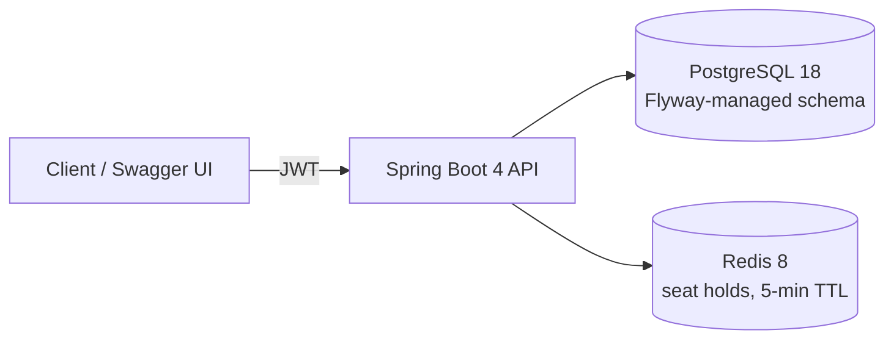
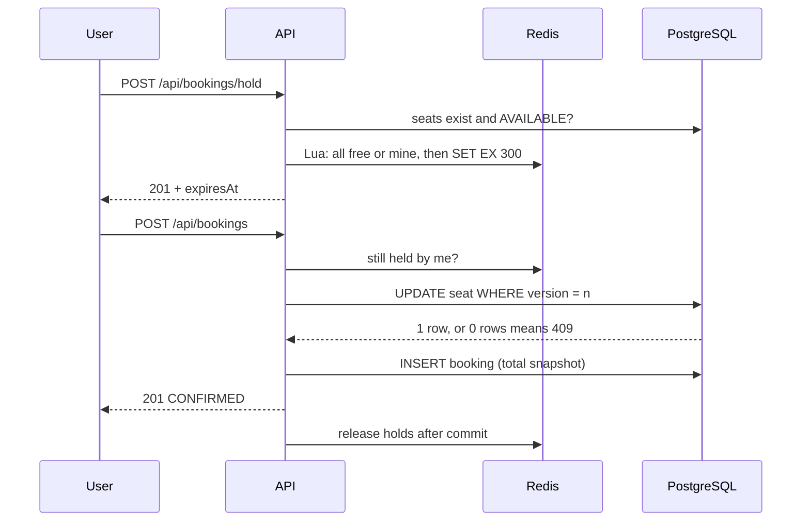

# BookMySeat 🎟️

[](https://github.com/Abhishek360007/BookMySeat/actions/workflows/ci.yml)


**Movie ticket booking API that guarantees one booking per seat under concurrent load.**

## Highlights

- **Redis seat holds with Lua:** selected seats are held for 5 minutes by one atomic script. Either every seat is held or none is, holds expire on their own, and this works across multiple app instances.
- **Optimistic locking (`@Version`):** the database is the final guard. When two confirms race for a seat, exactly one commit wins.
- **Proven with a 50-thread test:** Testcontainers tests fire 50 concurrent requests at one seat against real PostgreSQL and Redis, and CI runs them on every push.
- **Flyway-managed schema:** versioned SQL migrations, with Hibernate set to `validate`. CHECK constraints protect prices and totals in the database itself.
- **Stateless JWT security:** HS256 tokens, BCrypt passwords, and `USER` / `ADMIN` roles. Errors are RFC 9457 `ProblemDetail` responses.
- **Price snapshots and a cancellation cutoff:** a booking stores its total at booking time, and cancelling closes 2 hours before the show.
- **Production-ready extras:** paginated admin reports, Actuator health and business metrics, and a layered, non-root Docker image.

## Architecture



## Booking flow



## Concurrency proof

Measured by the Testcontainers tests in this repo: 50 threads are released at the same instant by a `CountDownLatch`.

| Scenario | Result |
|---|---|
| 50 users **hold** the same seat | **1** succeeds, 49 get `409` |
| 50 users **confirm** the same seat (holds mocked as valid) | `ok=1`, `lockLost=49`: exactly **1** booking |
| Same booking race **without `@Version`** | **50 bookings for one seat** (the test fails, as it should) |

## Design decisions

**Redis for holds, PostgreSQL for bookings.** Holds are short-lived, so Redis expires them with no cleanup job, and a Lua script makes "check all seats, then hold all" a single atomic step. Confirmed bookings are permanent records, so they live in PostgreSQL, the source of truth.

**Price is snapshotted.** `totalAmount = price × seats` is computed on the server when the booking is confirmed and is never recalculated. If an admin changes a show's price, past bookings keep what the customer actually paid, and the client can never send its own amount.

**`BigDecimal` for money.** In `double`, `0.1 + 0.2` is `0.30000000000000004`. Money is `BigDecimal` in Java and `NUMERIC(10,2)` in the database, and the API rejects more than 2 decimal places.

**Flyway with `ddl-auto=validate`.** The schema changes only through reviewed, versioned SQL files (`V1__init.sql`, `V2__...`). Hibernate checks on startup that the entities match the schema, and a migration that was edited after it ran fails its checksum check.

**Injectable `Clock`.** Time rules ("cancellation closes 120 minutes before start", "no booking after the show has started") read `Instant.now(clock)`. Unit tests use a fixed clock to cover the exact boundaries: 1 second before the cutoff, exactly at it, and 1 second after it.

**The `Asia/Calcutta` timezone bug.** On an Indian Windows machine the JVM's default zone is the legacy ID `Asia/Calcutta`. The PostgreSQL driver sends that zone to the server, and the PostgreSQL 18 test container rejected it with `invalid value for parameter "TimeZone"`. The app pins the JVM to UTC in `main()`, and Maven Surefire passes `-Duser.timezone=UTC` because tests don't run `main()`.

## API

Interactive docs: `/swagger-ui.html` (use **Authorize** to paste a JWT).

| Method | Path | Auth | Purpose |
|---|---|---|---|
| POST | `/api/auth/register` | Public | Create an account (always role `USER`) |
| POST | `/api/auth/login` | Public | Get a JWT access token |
| GET | `/api/users/me` | User | Current user's profile |
| GET | `/api/venues`, `/api/venues/{id}` | Public | Browse venues |
| POST / PUT / DELETE | `/api/venues/**` | Admin | Manage venues |
| GET | `/api/shows?venueId=`, `/api/shows/{id}` | Public | Browse shows and their prices |
| POST / PUT / DELETE | `/api/shows/**` | Admin | Manage shows |
| GET | `/api/shows/{showId}/seats` | Public | Seat map (`AVAILABLE` / `HELD` / `BOOKED`) |
| POST | `/api/shows/{showId}/seats` | Admin | Generate seats, e.g. 5 rows × 10 = A1–E10 |
| POST | `/api/bookings/hold` | User | Hold seats for 5 minutes |
| POST | `/api/bookings/hold/release` | User | Release your holds |
| POST | `/api/bookings` | User | Confirm held seats (total computed on the server) |
| POST | `/api/bookings/{id}/cancel` | User | Cancel, up to 2 hours before the show |
| GET | `/api/bookings/me` | User | Your bookings, newest first |
| GET | `/api/admin/shows/{showId}/bookings?status=&page=&size=&sort=` | Admin | Paginated bookings for a show (default `CONFIRMED`, newest first, max 100 per page) |
| GET | `/api/admin/shows/{showId}/summary` | Admin | Seats booked / held / available, confirmed bookings, revenue |

`401` means no valid token, and `403` means a valid token without the required role.

## Run locally

**Prerequisites:** Java 21 and Docker Desktop (running). Spring Boot starts PostgreSQL and Redis from `compose.yaml`, and Flyway creates the schema on first start.

```powershell
git clone https://github.com/Abhishek360007/BookMySeat.git
cd BookMySeat

# Optional: create an admin on startup (credentials never live in the repo)
$env:ADMIN_EMAIL="admin@bookmyseat.dev"
$env:ADMIN_PASSWORD="choose-a-strong-password"   # at least 12 characters

.\mvnw spring-boot:run        # macOS/Linux: ./mvnw spring-boot:run
```

Then open **http://localhost:8080/swagger-ui.html**.

| Variable | Purpose | Default |
|---|---|---|
| `JWT_SECRET` | HS256 signing key (at least 32 bytes) | Dev-only value. **Always set it in production.** |
| `ADMIN_EMAIL` / `ADMIN_PASSWORD` | Admin account created on startup | Not set (no admin is created) |

Hold duration and the cancellation cutoff are in [`application.properties`](src/main/resources/application.properties).

## Run with Docker

No Java needed: the app runs as a container next to PostgreSQL and Redis.

```powershell
copy .env.example .env      # then set ADMIN_EMAIL, ADMIN_PASSWORD and JWT_SECRET (.env is git-ignored)
docker compose --profile app up -d --build
```

Open **http://localhost:8080/swagger-ui.html**. To stop only the app container and keep the databases running, use `docker compose stop app`.

- **Multi-stage build:** the JDK and Maven exist only in the build stage; the runtime image has just the JRE.
- **Layered for caching:** dependencies are downloaded before the source is copied, and the jar is split into Spring Boot layers. A code change rebuilds only the small application layer (about 0.4 MB); a cached rebuild takes about 15 seconds.
- **Non-root:** the app runs as `uid=1001(app)`.
- **Profile-gated:** plain `docker compose up`, and Spring Boot's own Docker Compose support, still start only the databases.

## Monitoring

| Endpoint | Access | Shows |
|---|---|---|
| `/actuator/health` | Public | `UP` / `DOWN` only. Admins also see components: `db`, `redis`, disk. |
| `/actuator/health/liveness`, `/actuator/health/readiness` | Public | Probes for Kubernetes or a load balancer |
| `/actuator/info` | Public | Build artifact, version and time |
| `/actuator/metrics/{name}` | Admin | JVM, HTTP and the business metrics below |

| Metric | Tags | Counts |
|---|---|---|
| `bookings.confirmed` | none | Successful bookings |
| `bookings.cancelled` | none | Cancellations |
| `seat.holds` | `result` = `success` / `conflict` | Hold attempts, including lost hold races |
| `booking.conflicts` | `reason` = `hold_missing` / `already_booked` / `lock_lost` | Why confirms were rejected; `lock_lost` is an optimistic-lock race lost at commit |

Tags never contain user or seat ids, which keeps the number of distinct metrics small.

## Tests

```powershell
.\mvnw test
```

| Kind | Test | Covers |
|---|---|---|
| HTTP (MockMvc + Testcontainers) | `BookingApiTest` | The real HTTP contract with real logins: 401/403/400/409 `problem+json` shapes, field names, and the full hold → confirm → list → cancel flow |
| Unit (JUnit + Mockito, milliseconds) | `BookingServiceTest` | Cancellation cutoff boundaries and the "show already started" rule, with a fixed `Clock` |
| Integration (Testcontainers) | `SeatHoldConcurrencyTest` | 50 concurrent holds on one seat in real Redis: exactly 1 wins |
| Integration (Testcontainers) | `BookingConcurrencyTest` | 50 concurrent confirms in real PostgreSQL: exactly 1 booking |
| Integration (Testcontainers) | `BookMySeatApplicationTests` | The app starts and Flyway migrations V1 and V2 apply to an empty database |

The integration tests need Docker and never touch your dev database. GitHub Actions runs all of them on every push, then builds the Docker image.

## Roadmap

- [x] **Week 1:** Venues and shows CRUD, validation, `ProblemDetail` errors, Swagger
- [x] **Week 2:** Registration, JWT login, role-based security
- [x] **Week 3:** Seat maps, Redis holds, confirm/cancel with optimistic locking, concurrency tests
- [x] **Week 4:** Flyway migrations, price snapshots, cancellation cutoff, GitHub Actions CI
- [x] **Week 5:** Admin reports with pagination, HTTP-level API tests, Actuator health and metrics, Docker image
- [ ] **Next:** deploy the image to a public URL with live Swagger docs

## Author

**Abhishek Raj**: [GitHub @Abhishek360007](https://github.com/Abhishek360007)
