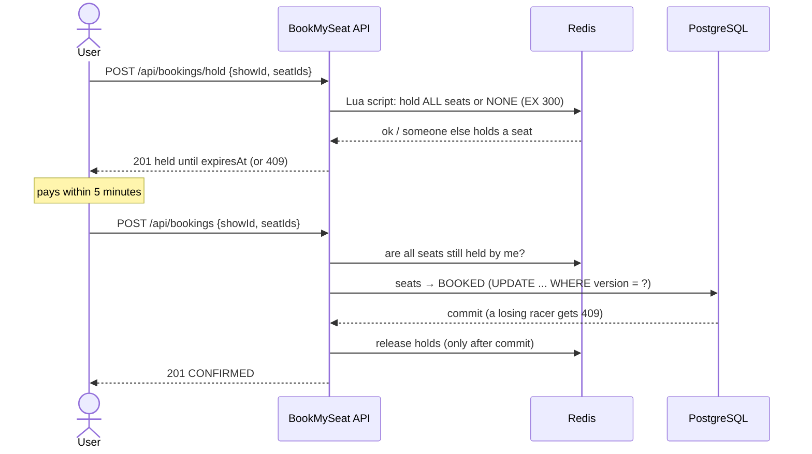

# BookMySeat 🎟️

A movie-ticket booking REST API built with **Spring Boot 4**, focused on the hard part of ticketing: **making sure two people can never book the same seat**, even when 50 of them click at the same moment.


> 🚧 Actively being built, week by week. See the [roadmap](#roadmap).

---

## Highlights

- **Two-layer double-booking protection**
  - **Redis seat holds:** selected seats are held for 5 minutes with an atomic Lua script (all-or-nothing, auto-expiring, safe across multiple app instances).
  - **Optimistic locking (`@Version`) in PostgreSQL:** the final safety net when confirming. If two transactions race, only one commit wins.
- **Proven under concurrency:** Testcontainers tests fire 50 threads at one seat. Exactly one hold wins and exactly one booking is created. Removing `@Version` makes the test fail with 50 bookings for one seat.
- **Price snapshots:** each booking stores its total (`price × seats`) at booking time, computed on the server with `BigDecimal`. Changing a show's price never alters past bookings.
- **Versioned schema:** Flyway migrations own the database; Hibernate only validates (`ddl-auto=validate`). CHECK constraints guard prices and totals in the database itself.
- **Stateless JWT security:** HS256 tokens, BCrypt-hashed passwords, and role-based access (`USER` / `ADMIN`).
- **Clean API errors:** every error is an [RFC 9457](https://www.rfc-editor.org/rfc/rfc9457) `ProblemDetail` with the correct status code and no stack traces.
- **Interactive docs:** Swagger UI with an "Authorize" button for JWT.

## Tech stack

| Area | Technology |
|---|---|
| Language / framework | Java 21, Spring Boot 4.1 (Web MVC, Data JPA, Validation, Actuator) |
| Security | Spring Security, OAuth2 Resource Server (JWT, HS256), BCrypt |
| Database | PostgreSQL + Hibernate, Flyway migrations |
| Cache / locks | Redis (seat holds via `SET` + TTL and Lua scripts) |
| API docs | springdoc-openapi (Swagger UI) |
| Testing | JUnit 5, Testcontainers (real Postgres and Redis), Mockito |
| Dev tooling | Docker Compose, Lombok, Maven Wrapper |

## How booking works



**Why Redis for holds instead of a "HELD" column?** Holds are temporary. Redis expires them automatically, so there's no cleanup job, and `SET NX` / Lua scripts give an atomic lock that works across many app servers. PostgreSQL stays the source of truth for confirmed bookings.

## API overview

Full interactive docs are at `/swagger-ui.html` once the app is running.

| Method | Endpoint | Access | Description |
|---|---|---|---|
| POST | `/api/auth/register` | Public | Create an account (always role `USER`) |
| POST | `/api/auth/login` | Public | Get a JWT access token |
| GET | `/api/users/me` | Logged in | Current user's profile |
| GET | `/api/venues`, `/api/venues/{id}` | Public | Browse venues |
| POST / PUT / DELETE | `/api/venues/**` | Admin | Manage venues |
| GET | `/api/shows?venueId=`, `/api/shows/{id}` | Public | Browse shows |
| POST / PUT / DELETE | `/api/shows/**` | Admin | Manage shows |
| GET | `/api/shows/{showId}/seats` | Public | Seat map (`AVAILABLE` / `HELD` / `BOOKED`) |
| POST | `/api/shows/{showId}/seats` | Admin | Generate seats, e.g. 5 rows × 10 = A1–E10 |
| POST | `/api/bookings/hold` | Logged in | Hold seats for 5 minutes |
| POST | `/api/bookings/hold/release` | Logged in | Release your holds |
| POST | `/api/bookings` | Logged in | Confirm held seats into a booking (total computed server-side) |
| POST | `/api/bookings/{id}/cancel` | Logged in | Cancel your booking (seats become available) |
| GET | `/api/bookings/me` | Logged in | Your booking history, newest first |
| GET | `/actuator/health` | Public | Health check |

**401 vs 403:** `401` means "no valid token", and `403` means "valid token, but your role isn't allowed".

## Getting started

### Prerequisites

- Java 21
- Docker Desktop (running)

### Run

```bash
git clone https://github.com/Abhishek360007/BookMySeat.git
cd BookMySeat
./mvnw spring-boot:run          # Windows: .\mvnw spring-boot:run
```

Spring Boot's Docker Compose support starts PostgreSQL and Redis from `compose.yaml` automatically. No database setup is needed: Flyway creates the schema from [`db/migration`](src/main/resources/db/migration) on first start.

Then open **http://localhost:8080/swagger-ui.html**.

### Create an admin account

Admins are created on startup from environment variables, so credentials never live in the repo:

```powershell
# PowerShell
$env:ADMIN_EMAIL="admin@bookmyseat.dev"
$env:ADMIN_PASSWORD="choose-a-strong-password"   # at least 12 characters
.\mvnw spring-boot:run
```

```bash
# bash
ADMIN_EMAIL=admin@bookmyseat.dev ADMIN_PASSWORD='choose-a-strong-password' ./mvnw spring-boot:run
```

### Configuration

| Variable | Purpose | Default |
|---|---|---|
| `JWT_SECRET` | HS256 signing key (at least 32 bytes) | Dev-only value. **Always set this in production.** |
| `ADMIN_EMAIL` / `ADMIN_PASSWORD` | Admin account created on startup | Not set (no admin is created) |

Other settings (token lifetime, hold duration) are in [`application.properties`](src/main/resources/application.properties).

## Running the tests

```bash
./mvnw test
```

Tests run against throwaway PostgreSQL and Redis containers (Testcontainers), so Docker must be running and your dev database is never touched.

| Test | What it proves |
|---|---|
| `SeatHoldConcurrencyTest` | 50 users hold the same seat at once: exactly **1** wins, 49 get a conflict |
| `BookingConcurrencyTest` | 50 users confirm the same seat at once: exactly **1** booking; the rest are stopped by `@Version` |

## Project structure

```
src/main/java/com/abhishekraj/BookMySeat
├── config/       Security (JWT, roles), OpenAPI, admin seeding
├── controller/   REST endpoints
├── dto/          Request/response records (entities are never exposed)
├── entity/       JPA entities: Venue, Show, Seat, Booking, User
├── exception/    Custom exceptions + global ProblemDetail handler
├── repository/   Spring Data JPA repositories
├── security/     JWT creation
└── service/      Business logic, incl. Redis seat holds
```

## Roadmap

- [x] **Week 1:** Venues and shows CRUD, validation, global error handling, Swagger
- [x] **Week 2:** Registration, login with JWT, role-based security
- [x] **Week 3:** Seat maps, Redis seat holds, booking confirm/cancel with optimistic locking, concurrency tests
- [ ] **Week 4 (in progress):** ✅ Flyway migrations · ✅ show prices and booking total snapshots · more coming

## Author

**Abhishek Raj**: [GitHub @Abhishek360007](https://github.com/Abhishek360007)
